# 2 — Creating a campaign: the Campaign Builder

**Who this is for:** the Account Manager for the client, or Traffic on their behalf.

**What you need before you start**

- The client and brand already exist (guide 1). The wizard lists them; it does not create them.
- The client has an account manager. It is filled in for you and is the person who can approve
  the campaign.
- The client's brief — as a document you can upload (PDF, Word) or text you can paste. Reference
  material (decks, previous work) is optional.
- Each department that will do work needs a **brief template** assigned under
  **Admin → Brief templates**. Without one, that department cannot write its brief later. The last
  step of the wizard tells you if one is missing.

**When to use a single job instead:** one request, one deliverable, one department — see guide 3.
The Campaign Builder is for anything with several deliverables or several departments.

---

## The steps

### 1. Open the Campaign Builder

Go to **Campaigns** and press **+ New** at the top right (or `Ctrl P` anywhere in Maestro). Choose
**Full campaign**. The builder has five steps; you can leave at any point and the draft is kept.

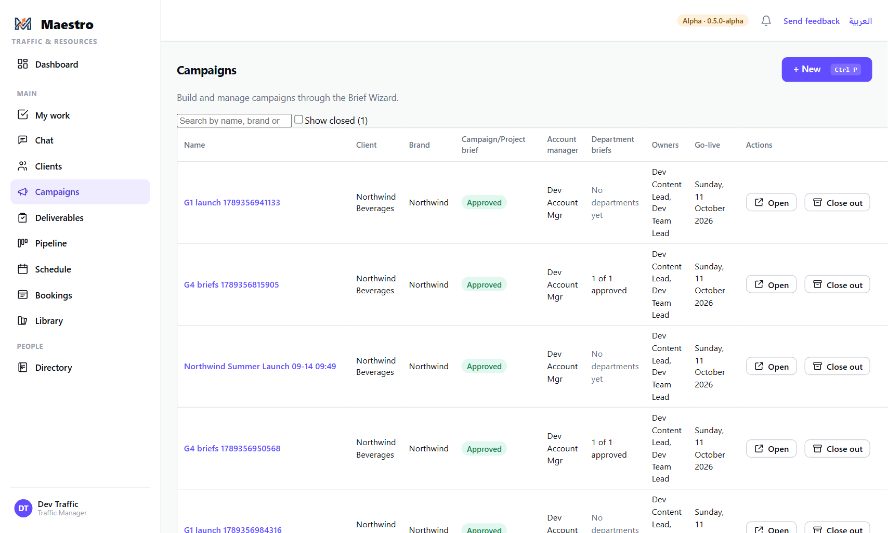

### 2. Job Type — who it is for

Pick the **client** and **brand**, and give the campaign a **name** that will be unique for this
client. The **account manager** fills in from the client; change it only if somebody else is
handling this campaign.

Below that, **evidence the brief was requested**: paste or upload a screenshot of the request as it
arrived (email, WhatsApp, Teams). Maestro reads the subject, date and time off it. That date and
time is when the client's clock starts — the response time is measured from it, not from now.
Crop to the request itself: the screenshot is filed in the Library and read by the AI service.

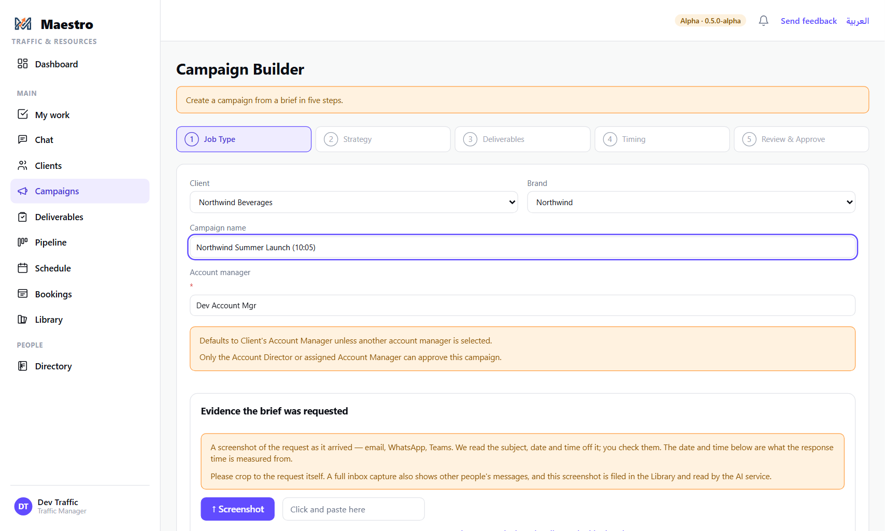

Press **Next**.

### 3. Strategy — the campaign brief

This step has three parts, top to bottom:

- **Read the client's brief.** Upload the document (or paste its text) and press **Read it and
  fill the fields below**. The AI reads the document and fills in as many of the strategy fields as
  it can. Each filled field is marked; read it and press **Keep** on each one, or edit it first.
- **Campaign reference materials.** Anything supporting the brief — decks, references, previous
  work. These are filed against this campaign in the Library (Deliverables, Final Assets and
  References folders are created for you; add your own with **+ New folder**).
- **The strategy fields** — Background, The task, The beautiful problem, Audience, Brand benefits,
  Insight, Proposition. This is written **once**: every department's brief carries it.

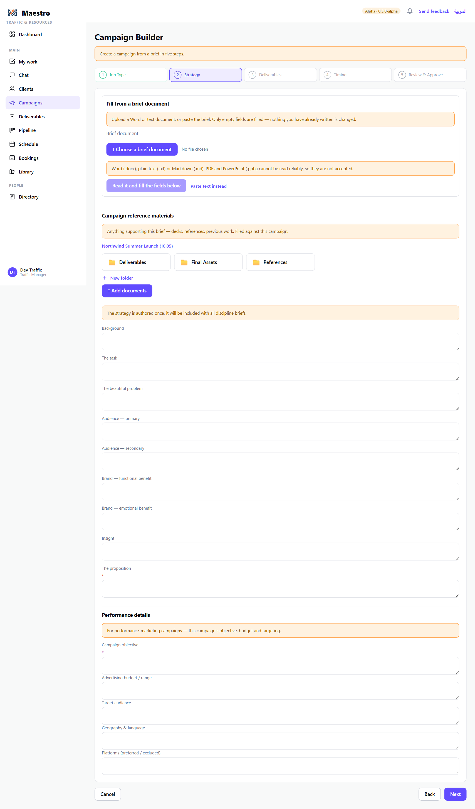

Only the Proposition is required to move on; fill in what you know. Press **Next**.

### 4. Deliverables — what is being made, and who owns each

Maestro proposes a list of deliverables from the brief. Each row has a **category**, a
**type** (from the agency's own list — Billboard, Social Advertisement, and so on), a **channel**,
a **format** and a **quantity**. Correct anything, delete a row with the bin, add one with
**+ Add deliverable**.

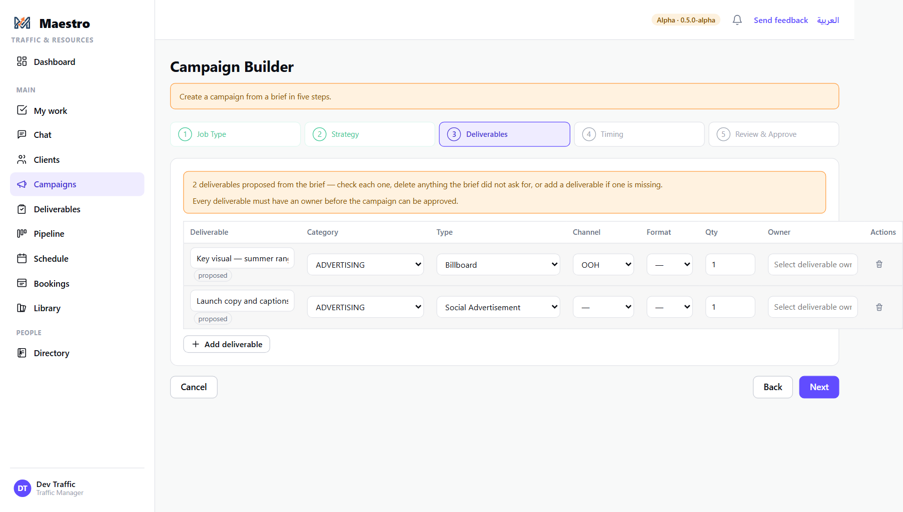

Every deliverable must have an **owner** — the person accountable for it. Start typing a name; the
picker offers department leads and team leaders only, never a team member and never "nobody".

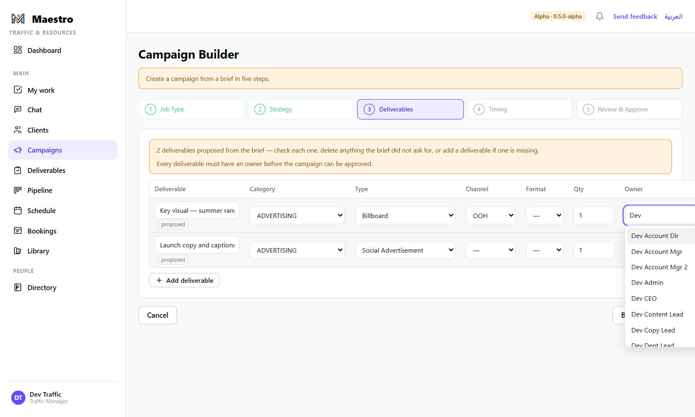

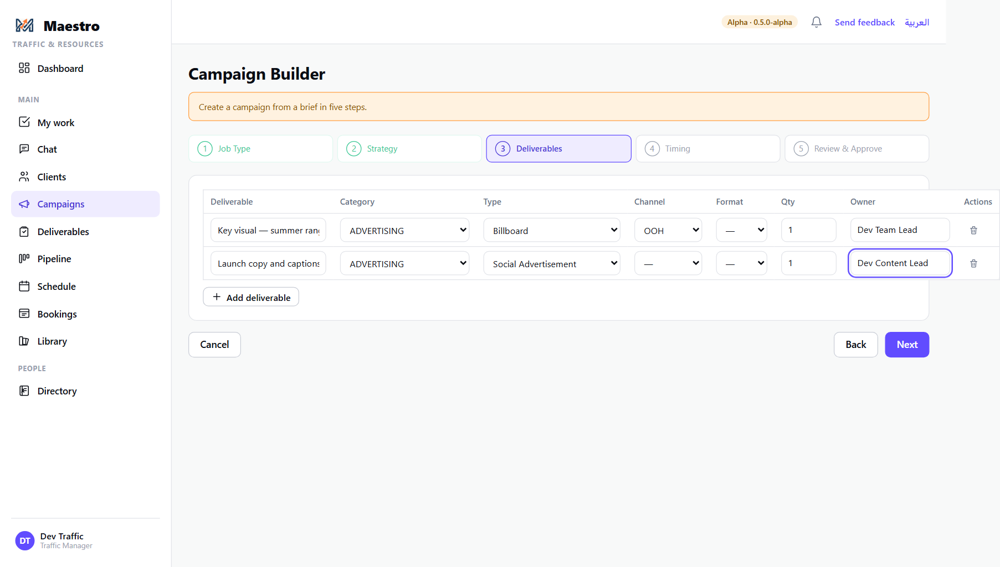

**The type matters.** A typed deliverable gets its department's task list automatically (Creative
Direction, Develop Concept, Write Copy, Create Artwork…). An untyped one has no tasks until
somebody adds them by hand.

Press **Next**.

### 5. Timing — go-live and due dates

Set the **campaign go-live** date. Maestro fills in each deliverable's **Due by** and
**Commence by** from it, using the agency's scheduling rules (Admin → Organization → Scheduling
rules): delivery a set number of working days before go-live, work starting a set number of working
days before that. Weekends and declared office closures are skipped. You can overtype any date.

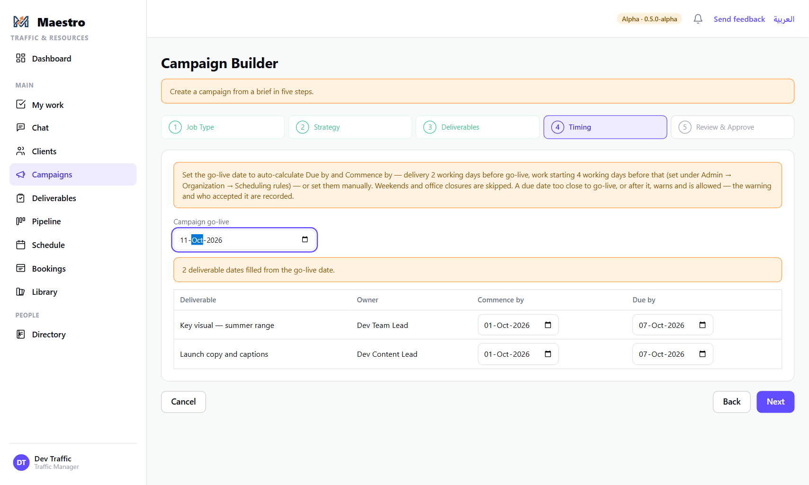

If a due date is too close to go-live, an amber line appears under it saying how many working days
are left and what the rule asks for. **You can still proceed** — the override is recorded against
the deliverable, with your name.

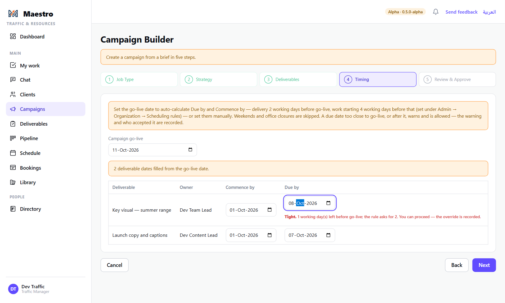

A date **after** go-live is also allowed, with a red warning: it will need the client's agreement,
and that too is recorded.

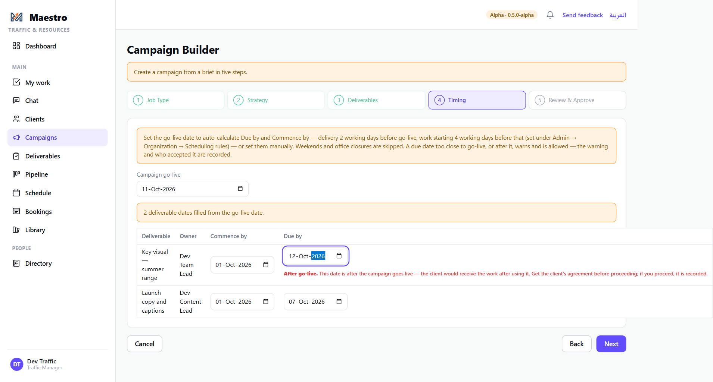

Press **Next**.

### 6. Review & Approve

Everything on one page: the campaign brief, all deliverables with their owners and dates, and the
**brief approvers** line, which tells you whether every department has a brief template.

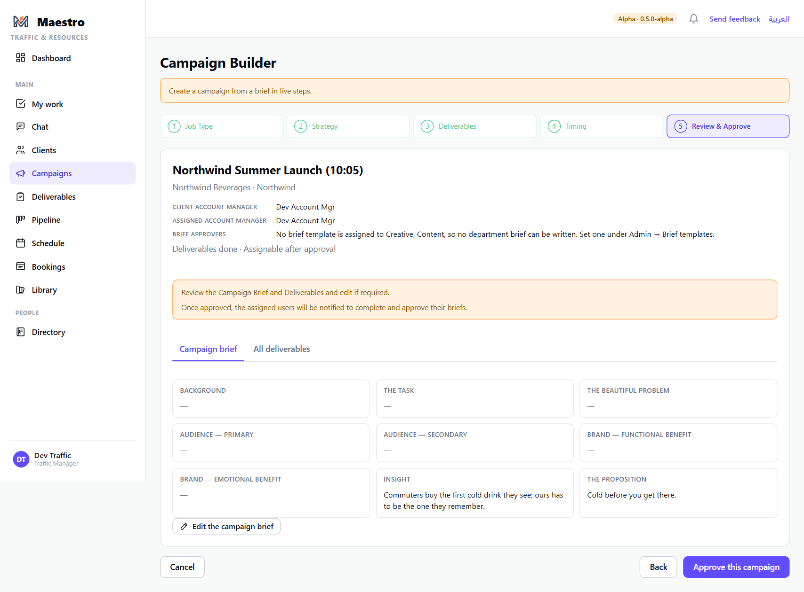

Use **Edit the campaign brief** or go **Back** to change anything. When it is right, press
**Approve this campaign**. This creates the campaign *and* approves it in one press — there is no
separate approval step afterwards.

You land on the campaign page. The campaign brief is on its tab, and each department has a tab of
its own, empty until that department writes its brief (guide 4).

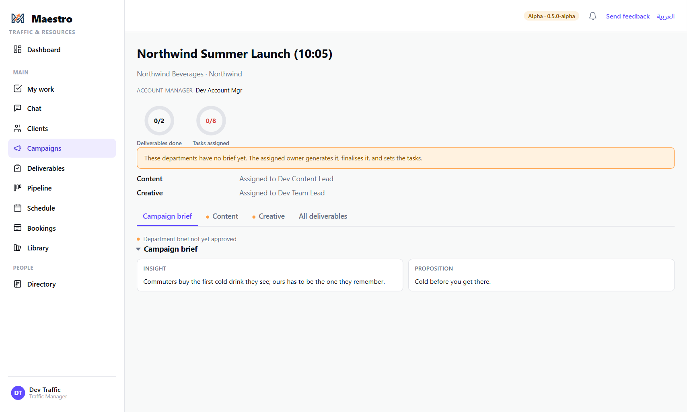

---

## The rules

- **Names are unique per client.** A second campaign with the same name for the same client is
  refused; pick a name that will still make sense next year.
- **Every deliverable has an owner.** The picker will not let you leave one without.
- **Dates warn; they do not block.** Tight, impossible and after-go-live dates all go through,
  and every one is recorded: who accepted it, how many days short, on which deliverable.
- **The approval is the account manager's** (or the Account Director's). Traffic and the Power
  Admin can stand in when they are away — Maestro lets them — but the promise to the client is
  the account manager's, so the habit should be that they press it.
- **A draft is kept.** Leave and come back from Campaigns → *Drafts* → **Resume**; it opens at the
  step you left. Discard a draft with the bin.

## What happens next

- Each deliverable's **owner is notified** that the campaign is approved.
- Each department writes and approves its own brief on its tab of the campaign page (guide 4).
  **None of a department's work can be assigned until its brief is approved.**
- Typed deliverables already have their task list; the owner reviews it (guide 5) and the
  department's leads — or Traffic — assign the work on the schedule (guide 6).
