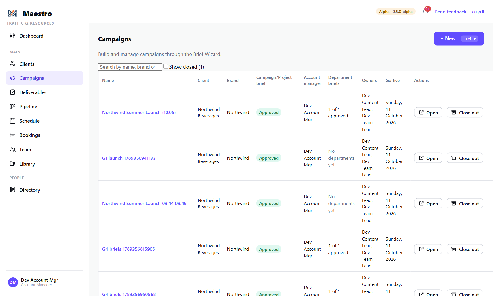
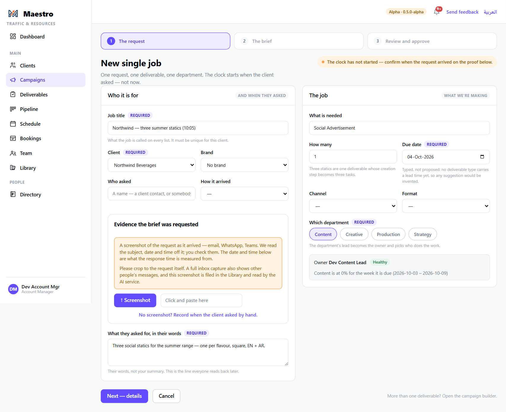
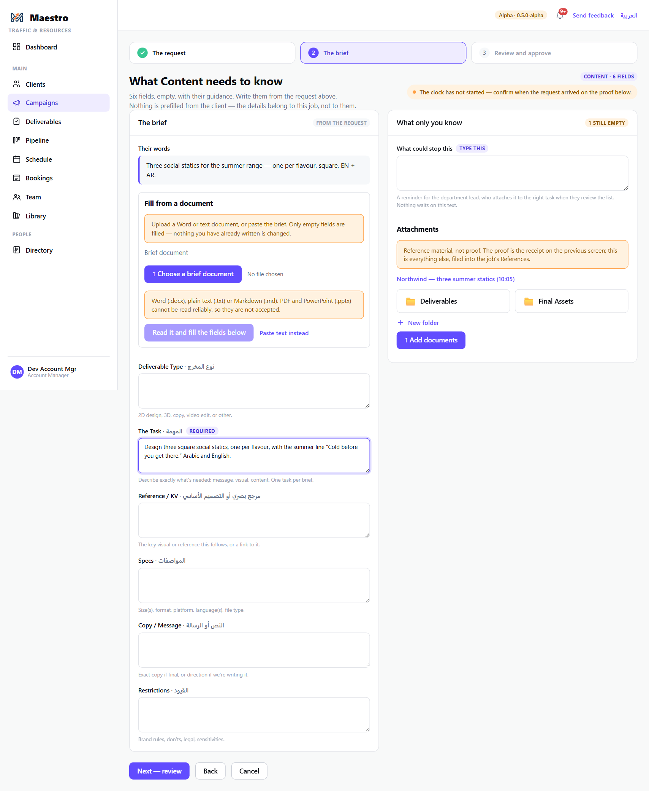
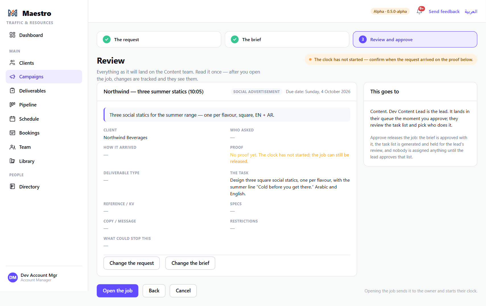
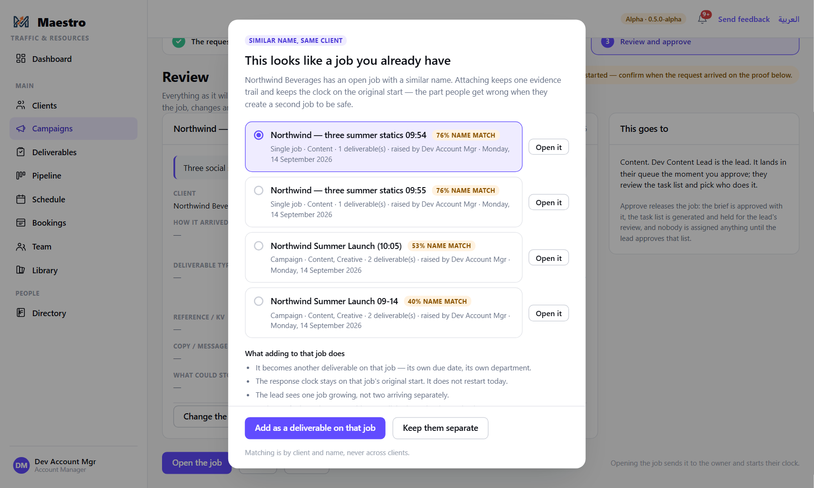
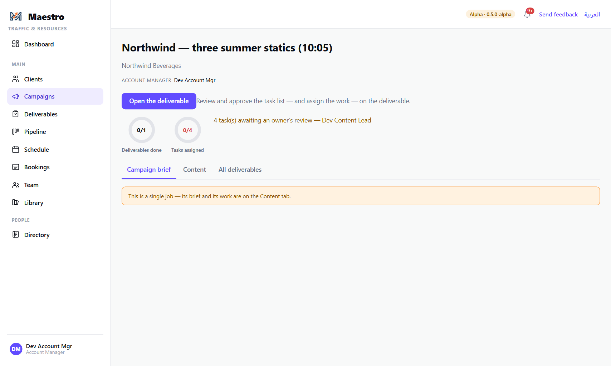

# 3 — Creating a single job

**Who this is for:** the Account Manager who received the request, or Traffic on their behalf —
or a colleague capturing it for them. Anyone who can create campaigns can fill in the request,
the evidence and the brief; **only the client's account manager can press Approve.**

**What a single job is:** one request, one deliverable, one department. Three screens — the
request, the brief, review — and the job is released to the department lead. If the client wants
several things, or work from more than one department, use the Campaign Builder instead (guide 2).
A single job can be **promoted** to a campaign later without retyping.

**What you need before you start**

- The client exists (guide 1).
- Proof of the request: a screenshot of the email, WhatsApp or Teams message as it arrived. This is
  what starts the client's clock. You can release the job without it, but the clock does not start
  until it is filed or you record the arrival by hand.
- The client's own words for what they asked for.

---

## The steps

### 1. Open the door

Press **+ New** on the Campaigns page, or `Ctrl P` from anywhere. Choose **Single job**.

### 2. The request — who it is for, and what

The left-hand card is **who asked and when**; the right-hand card is **what we are making**.

Left:

- **Job title** — what the job is called on every list. Unique for this client.
- **Client**, and the **brand** if there is one.
- **Who asked** and **how it arrived** (email, WhatsApp…).
- **Evidence the brief was requested** — press **Screenshot** to upload, or click the box and
  paste. Maestro reads the subject, date and time off the image; check them. Crop to the request
  itself: a full inbox capture shows other people's messages, and the screenshot is filed in the
  Library. No screenshot? Use **Record when the client asked by hand** — the clock starts from the
  time you enter.
- **What they asked for, in their words** — their words, not your summary. This is the line
  everyone reads back later.

Right:

- **What is needed** — start typing and pick a deliverable type from the agency's list (Social
  Advertisement, TV Advertisement…). A typed job gets its department's task list automatically;
  an untyped one has no tasks until somebody adds them.
- **How many** — three statics are one deliverable whose creation step becomes three tasks.
- **Due date** — required. Typed by you, not proposed.
- **Which department** — the department's lead becomes the deliverable's owner and picks who does
  the work. If the department has no lead, you are asked which team leader owns it. The card below
  shows the department's load in the week the job is due, so you know what you are asking of them.

Press **Next — details**.

### 3. The brief — what the department needs to know

Six fields for the department, empty, each with its guidance: the task, reference / key visual,
specs, copy / message, restrictions, and **what could stop this**. Nothing is prefilled from the
client record — these details belong to this job.

You can also **fill from a document**: upload the client's brief and the AI fills what it can. Each
filled field must be read and confirmed with **Keep** (or edited) before you can go to review.
Attachments here are reference material, filed into the job's References — the *proof* is the
screenshot on the previous screen.

"What could stop this" is a reminder for the department lead; when they review the task list they
attach the real dependency to the right task. Nothing waits on the text itself.

Press **Next — review**.

### 4. Review and open the job

Everything as it will land on the department, on one page. The right-hand card says **where it
goes** and what opening does.

Use **Change the request** / **Change the brief** to go back. When it is right, press
**Open the job**.

**If Maestro finds a similar job for the same client**, it asks before opening a second one:

- **Add as a deliverable on that job** — the request becomes another deliverable on the existing
  job, with its own due date and department. The response clock stays on the original job's start;
  the lead sees one job growing rather than two arriving.
- **Keep them separate** — a new job, as you intended.

Matching is by client and name; it never matches across clients.

### 5. The job is open

You land on the job's page. The brief is approved with it, the task list is generated and **held
for the lead's review**, and nobody is assigned anything until the lead approves that list
(guide 5).

---

## The rules

- **The clock starts when the client asked, not when you typed.** It is read from the screenshot,
  or from the time you record by hand. Until one of those exists the job is open but the clock
  has not started, and the review page says so.
- **Titles are unique per client.**
- **Opening the job is the approval.** There is no second approval step; the brief goes with it.
- **Approve is the account manager's.** If you are not this client's account manager, everything
  you entered — request, screenshot, brief — is saved, and the message names who can approve. They
  find the job on the campaigns list and press Approve there. If the client has no account
  manager yet, set one on the client record first.
- **After you open it, changes are tracked** and the department lead sees them.
- **Nobody is assigned anything until the lead approves the task list.**

## What happens next

- The department lead (the deliverable's owner) is notified. The job is in their queue with the
  task list held for review (guide 5).
- Once the list is approved, the lead (or Traffic) assigns the tasks on the schedule (guide 6).
- If this turns into more than one deliverable, **Promote** it to a campaign from the Campaigns
  list; nothing is retyped — the job's words become the campaign brief, and the department is asked
  to write its campaign-scale brief before any new work is assigned (guide 13).
