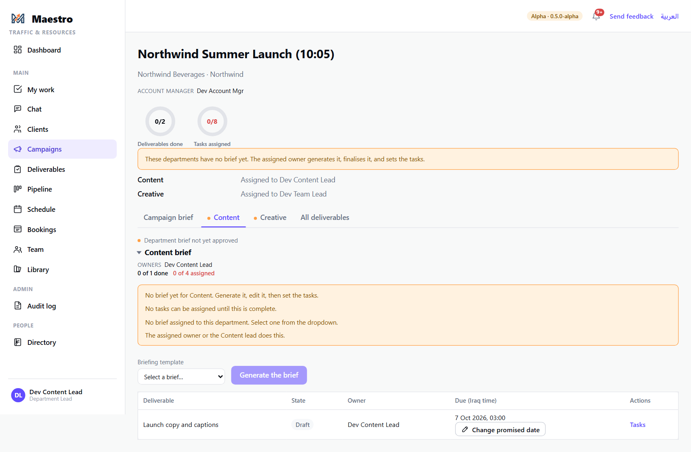
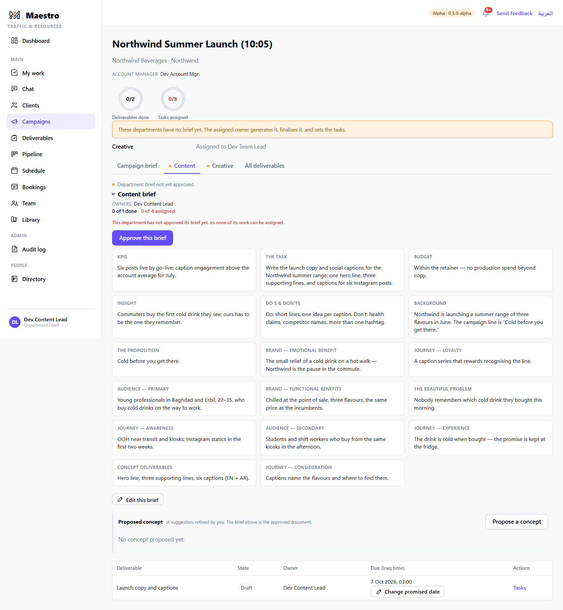
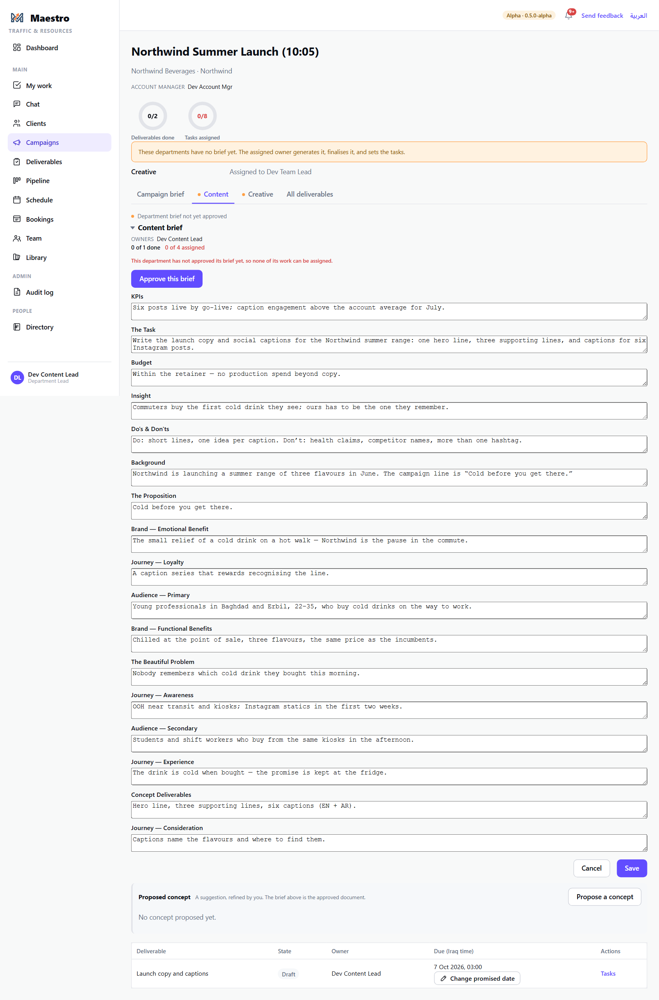
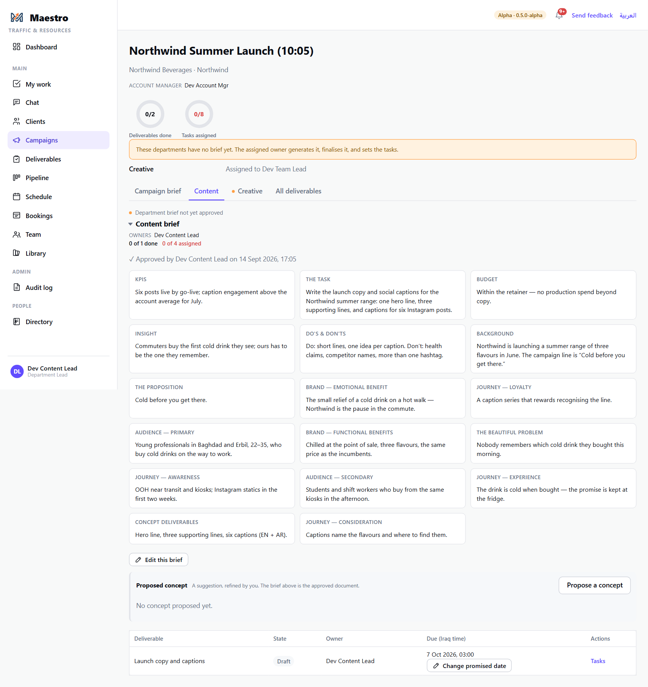

# 4 — The department brief: generate, edit, approve

**Who this is for:** the Department Lead (or the team leader who owns the deliverable) of each
department that has work on an approved campaign.

**Why this exists:** the account manager wrote *one* campaign brief. Your department needs its own
— the Content brief is not the Creative brief. Maestro generates a first draft for you from the
campaign brief and the client's documents, on your department's own template; you read it, fix it,
and approve it. **Until you approve it, none of your department's work can be assigned.**

**What you need before you start**

- The campaign is approved (guide 2). You were notified when it was.
- Your department has a **brief template** under Admin → Brief templates. If it has several, you
  will choose which one to write from; if it has one, that one is used; if it has none, ask the
  Power Admin to assign one — the tab tells you so.

**Single jobs are different.** On a single job the account manager wrote the department's brief
directly and it was approved with the job — there is nothing to generate. Go straight to the task
list (guide 5).

---

## The steps

### 1. Open the campaign and your department's tab

From the notification, or **Campaigns → Open**. The campaign page has a tab for the campaign brief
and one for each department with work. An amber dot on a tab means that department's brief is not
approved yet. The banner above the tabs lists the departments still without a brief and who owns
them.

### 2. Generate the brief

On your tab: if your department has more than one template, pick one from the dropdown. Press
**Generate the brief**. Maestro reads the campaign brief and the filed documents and writes a first
draft into every field of the template. A "please wait" dialog shows while it works; it takes a
few seconds.

### 3. Read it, and edit what is wrong

The draft appears as the department brief, field by field. **It is a draft** — read every field.
Press **Edit this brief** to change any of them, then save.

### 4. Approve it

Press **Approve this brief**. The status line changes to *approved by you, at this time*, the amber
dot leaves the tab, and the deliverables under it can now be assigned.

### 5. Optional — propose a concept

Below the brief, **Propose a concept** asks the AI for one working concept built on the approved
brief: a set of items you can **keep** or **delete** one by one, then **Regenerate removed** to fill
only the deleted slots. It is a suggestion refined by you; the brief above stays the approved
document. Only people who can manage projects see the button.

---

## The rules

- **Each department approves its own brief.** The people who may press Approve on a department's
  tab are: that department's lead and team leaders, the campaign's account manager, the Account
  Director, Traffic and the Power Admin. A team member cannot; an account manager for a
  *different* client cannot — Maestro refuses and says why.
- **No approved brief, no assignment.** The tab says it in red: *"This department has not approved
  its brief yet, so none of its work can be assigned."* If anyone tries to book one of the tasks,
  Maestro refuses the booking and says why.
- **Generating needs a template.** No template assigned → the Generate button tells you to ask an
  admin. Generating is behind the project-management permission, so a team member does not see it.
- **The campaign brief is shared; the department brief is yours.** Changing the campaign brief
  afterwards does not rewrite your department brief.

## What happens next

- The deliverable's tasks are already listed (from the deliverable's type). Review the task list —
  add, remove, reorder, and note what each task is waiting on (guide 5).
- You, your team leaders, or Traffic book the tasks on the schedule (guide 6). Each assignee is
  told when their task is assigned.
