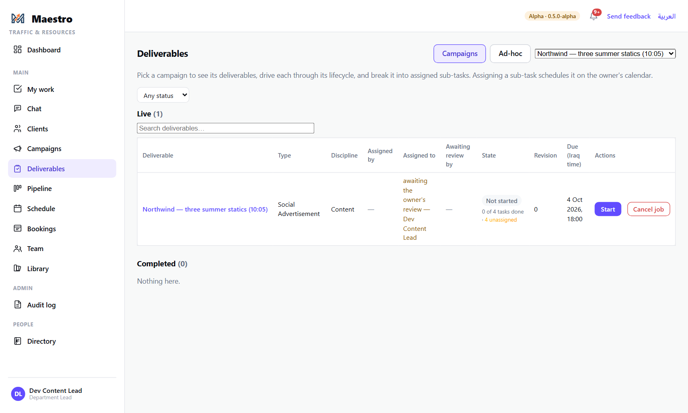
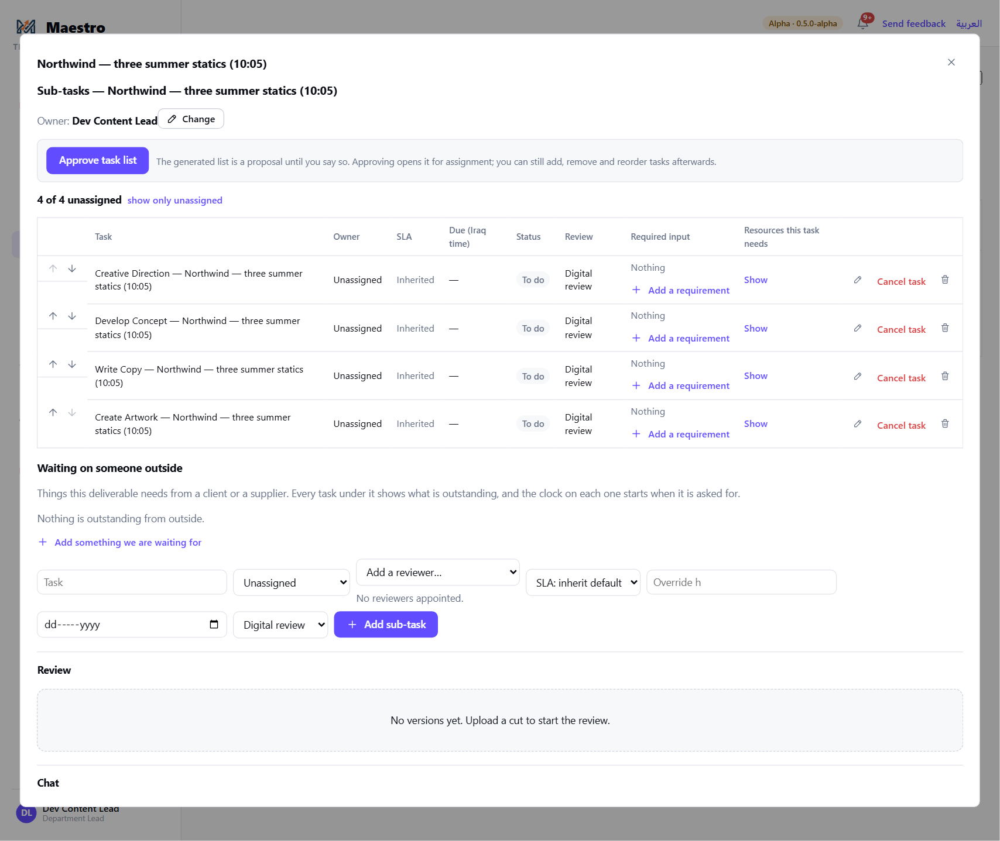
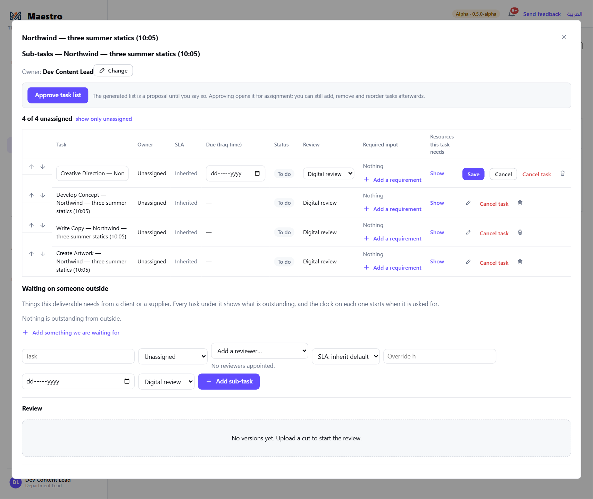
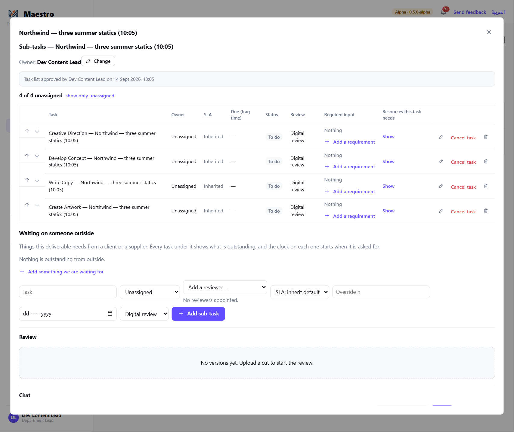
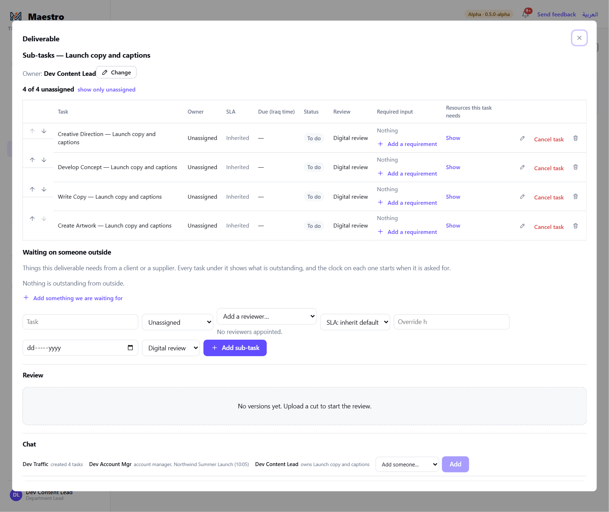

# 5 — Reviewing and approving the task list

**Who this is for:** the **owner** of a deliverable — normally the department lead, or the team
leader named as owner when the department has no lead. Traffic can stand in for an absent owner.

**What a task list is:** every typed deliverable comes with its department's standard tasks
(for a Social Advertisement: Creative Direction, Develop Concept, Write Copy, Create Artwork). That
list is a **proposal** until you say so. You add, remove, rename and reorder tasks, say what each one
is waiting for, and — on a single job — approve the list so assigning can start.

**Two cases, one screen**

- **Single job:** the list is **held** until you approve it. Nobody can be assigned anything on it
  before then. The **Approve task list** button is yours.
- **Campaign:** your department already accepted the work by approving its brief (guide 4), so the
  list is not held — it is assignable as soon as the brief is. Review and edit it the same way;
  there is simply no Approve button.

---

## The steps

### 1. Find the deliverable

You were notified when the job was opened (or the campaign approved). Go to **Deliverables** and
pick the job or campaign from the dropdown at the top right. A held deliverable says so in the
*Assigned to* column: *awaiting the owner's review — you*.

Click the deliverable's name to open it.

### 2. Read the list

The detail dialog shows the owner, the tasks in order, and for each task: who owns it, its SLA, due
date, status, review mode, what it is waiting for (**Required input**) and the resources it needs.
Below the list: **Waiting on someone outside** (things the client or a supplier still owes) and the
**Add sub-task** form.

### 3. Change what needs changing

- **Rename a task, change its date or reviewer** — the pencil on the row; **Save** or **Cancel**.
- **Reorder** — the up / down arrows at the start of the row. Order is the order the work happens;
  it does not move any dates.
- **Remove a task** — the bin. A task somebody is already on asks first, by name, because removing
  it also removes their booking. A task nobody was ever given goes without a dialog.
- **Cancel a task** instead of removing it when you want the record kept.
- **Add a task** — the form at the bottom: title, assignee (or leave it unassigned for now),
  reviewer, SLA, due date, review mode, then **+ Add sub-task**. A task you leave unassigned
  belongs to your department until somebody is named on it. Naming somebody from another
  department is a request that department's lead answers (guide 6) — you cannot book them
  yourself, and the list says so.
- **What is it waiting for?** — **+ Add a requirement** on a task names what must exist before
  that task can start (a client's logo files, a script sign-off). The task shows it, and the
  assignee sees it on My Work.
- **Waiting on someone outside** — **+ Add something we are waiting for**: a thing the client or
  a supplier owes, with who owes it. The clock on it starts when it is asked for.

The account manager's **"What could stop this"** note from the request appears above the list on a
single job. It is a reminder for you: attach the real dependency to the right task; nothing waits
on the note itself.

### 4. Approve the list (single job)

Press **Approve task list**. The stamp *Task list approved by you on …* replaces the button, the
held label leaves the Deliverables page, and the tasks can now be booked.

You can still add, remove and reorder tasks afterwards; approving opens the list for assignment, it
does not freeze it.

### 5. A campaign deliverable

The same dialog, with no Approve button. Everything in step 3 applies.

---

## The rules

- **Only the owner approves** — and, standing in, anyone who may change the owner: Traffic and the
  Power Admin. The account manager who opened the job has no Approve button.
- **Until the list is approved, nothing on a single job can be assigned.** A booking is
  refused, whoever makes it.
- **Changing the owner.** Press **Change** beside the owner's name. You are offered your own
  department's leads and team leaders — never a team member, never "nobody". Both the old and the
  new owner are told; the person making the change is not.
- **Quantity does not split a deliverable.** Three statics are one deliverable; only the
  *creation* step (Create Artwork) becomes three tasks.
- **A task always has at least one reviewer** once it is assigned. Maestro will not let it be
  saved without one.

## What happens next

- You, your team leaders, or Traffic book each task on the schedule (guide 6). Booking a task *is*
  assigning it: the assignee is told, the task appears on their My Work, and its dates follow the
  booking. Booking someone outside your own department or team is a request their lead answers.
- If you are also the one doing the work, assign it to yourself from the form here or from the
  schedule.
