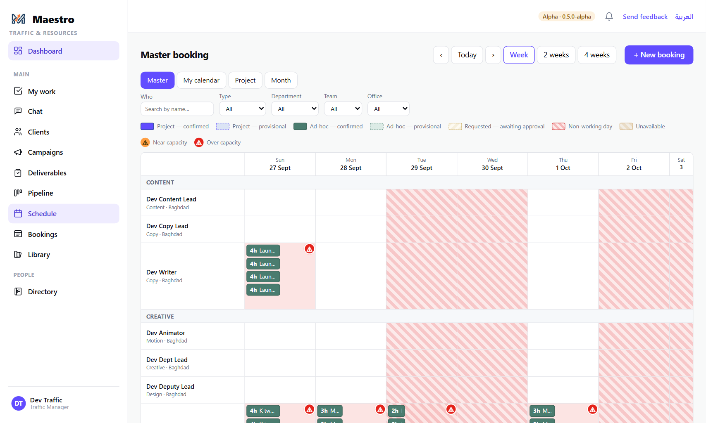
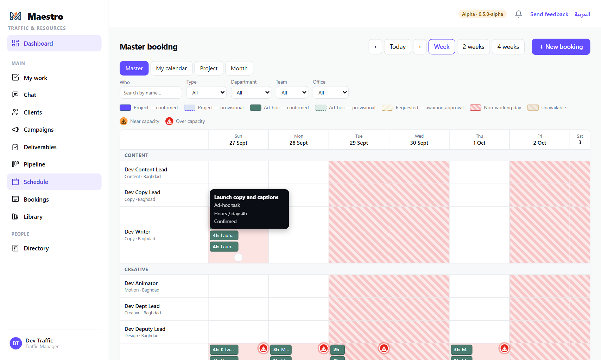
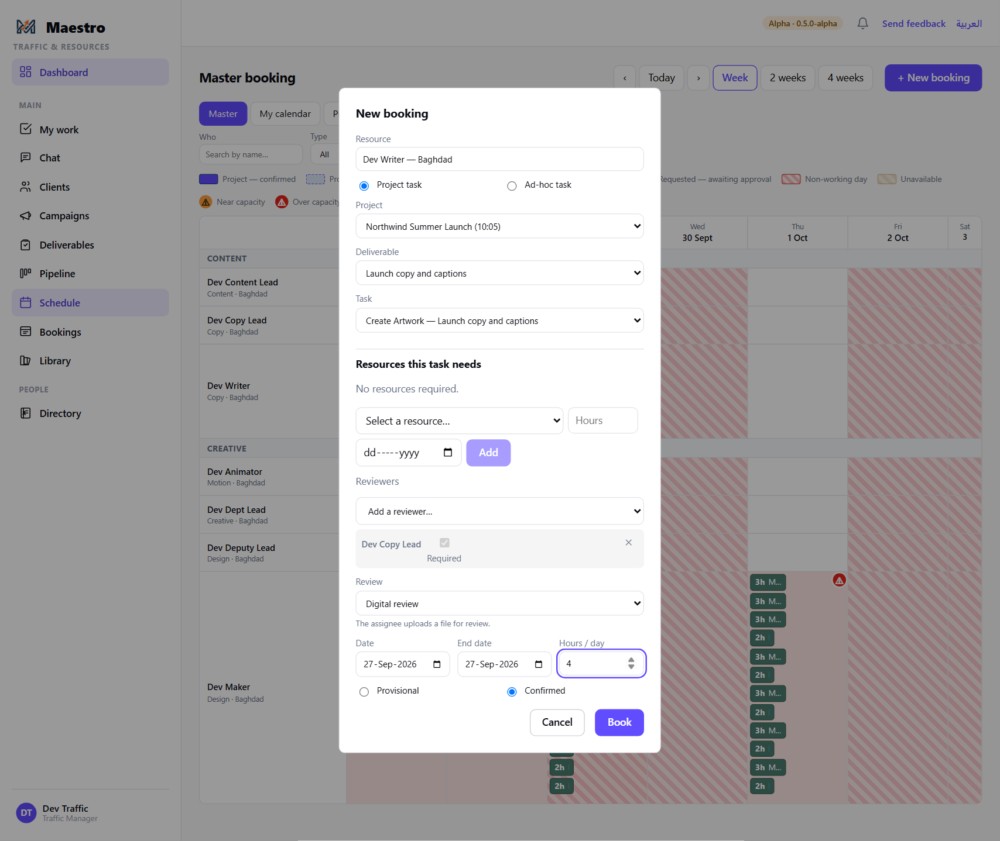
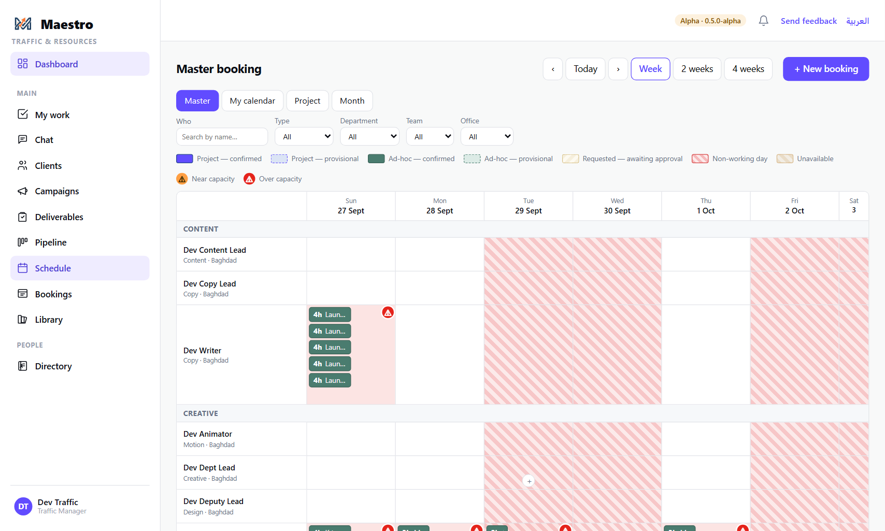

# 6 — Assigning work on the schedule

**Who this is for:** everyone who assigns work — **team leaders**, **department leads**, **account
managers**, **Traffic** and the Power Admin. Since 22 Sep any of them books anyone, in any
department.

**The one idea to hold on to:** in Maestro, **booking a task on somebody's calendar is assigning
it**. There is no separate "assign" step. The booking puts the task on their My Work, tells them,
and sets the task's dates. Move the booking and the dates move with it.

**What you need before you start**

- The task exists and is assignable: on a single job, the owner has approved the task list
  (guide 5); on a campaign, the department has approved its brief (guide 4).
- You know who is doing it, roughly how many hours a day, and who will review it.

---

## The steps

### 1. Open the schedule on the right week

**Schedule** shows the *Master booking* grid: people and resources down the side, days across the
top, grouped by department. Use **‹ Today ›** and **Week / 2 weeks / 4 weeks** to move. Shaded
days are non-working days for that person's office; hatched days are declared unavailable or
closed.

### 2. Add a booking on the person and the day

Hover over the cell for the person and the day the work starts; a **+** appears. Click it.
(**+ New booking** at the top right opens the same dialog with nothing pre-filled.)

### 3. Fill in the booking

- **Project task** (the default) or **Ad-hoc task** for work that belongs to no campaign.
- **Project** — the campaign or job. **Deliverable** — which one. **Task** — the list offers only
  tasks that are still waiting to be given out; one already assigned is a chip on the grid and is
  moved by dragging it. **+ New task…** creates a task on the spot.
- **Resources this task needs** — a room, a camera, a studio: pick the resource, hours and date
  and **Add**. If a resource is over capacity on those days it is booked anyway and you are told.
- **Reviewers** — at least one. Exactly one is **Required** (the first you add); any others are
  optional. The required reviewer's approval is the one that completes the task; optional
  reviewers answer, and the task waits for every answer before it can complete.
- **Review** — **Digital review**: the assignee uploads a file. **Manual review**: the work
  produces no file (an installation, a shoot day); the assignee writes what they did and the
  reviewer approves from that.
- **Date**, **End date**, **Hours / day**. A task longer than a day spreads across working days.
- **Provisional** or **Confirmed**.

Press **Book**.

### 4. If Maestro warns

A booking that pushes the person over their capacity for the day, or lands on a non-working day,
comes back with the reason and the button changes to **Proceed anyway**. Nothing is booked yet.
Read the reason, then either change the date or hours, or press **Proceed anyway** — the overload is
recorded and shown on the grid as a warning triangle.

### 4a. Booking someone outside your own team or department

You can book across departments — a Creative lead booking a Production editor — on your own
authority, exactly as you book your own people. The booking is made at once, the person is told,
and their own lead is not: there is no request and no approval step (that step existed until
22 Sep and was removed). What still warns you is capacity: the person's load and their department's
load are shown before you press **Book**, and an overload is a warning you can proceed past.

Leave is the one thing that stays with the person's own lead — you can put work on anybody's
calendar, but you record leave only for your own people (guide 11).

### 5. The chip is on the grid

The booking appears as a chip with its hours. The assignee is notified and the task is on their
My Work with the booking's dates.

### 6. Moving and changing a booking

- **Drag the chip** to another day or another person. If the move overloads somebody or lands on a
  non-working day, a dialog says so (*"That day goes to 115% load"*) and asks **Move it anyway?**
- **Click the chip** to open it: change dates, hours, the person, reviewers or the review mode.
  If the new date is later than the task's committed date, the dialog offers to raise a deadline
  extension request in the same save (guide 9). It offers; it never forces.
- **Cancel booking** (or **Cancel task**) from the same dialog. Cancelling a task releases its
  booking and tells the assignee.

---

## The rules

- **Who can book whom.** Anyone who may book — a team leader, a department lead, an account
  manager, Traffic, the Power Admin — books anyone, in any department (ADR-0098, 22 Sep). A team
  member books nobody, not even themselves. The person's own lead is not asked and not told.
- **A task has one assignee.** Re-booking to another person reassigns it; the first person is told.
- **Capacity warns; it does not block.** Over-capacity, non-working days and closures all warn
  with the number and let you proceed. Every override is visible on the grid.
- **Every assigned task has a reviewer.** The dialog will not book without one.
- **The booking is the plan; the commitment is separate.** Dragging a chip moves the task's
  dates. It does not move the deadline the assignee committed to — that changes only through an
  extension request the account manager approves (guide 9).
- **No approved brief / task list, no booking.** Maestro refuses and names the reason.

## What happens next

- The assignee sees the task on **My Work**, starts it and submits it for review (guide 7).
- The reviewer sees it under **Awaiting my review** when it is submitted (guide 8).
- Traffic sees load per person and per department on the **Dashboard** and the **Team** page.
