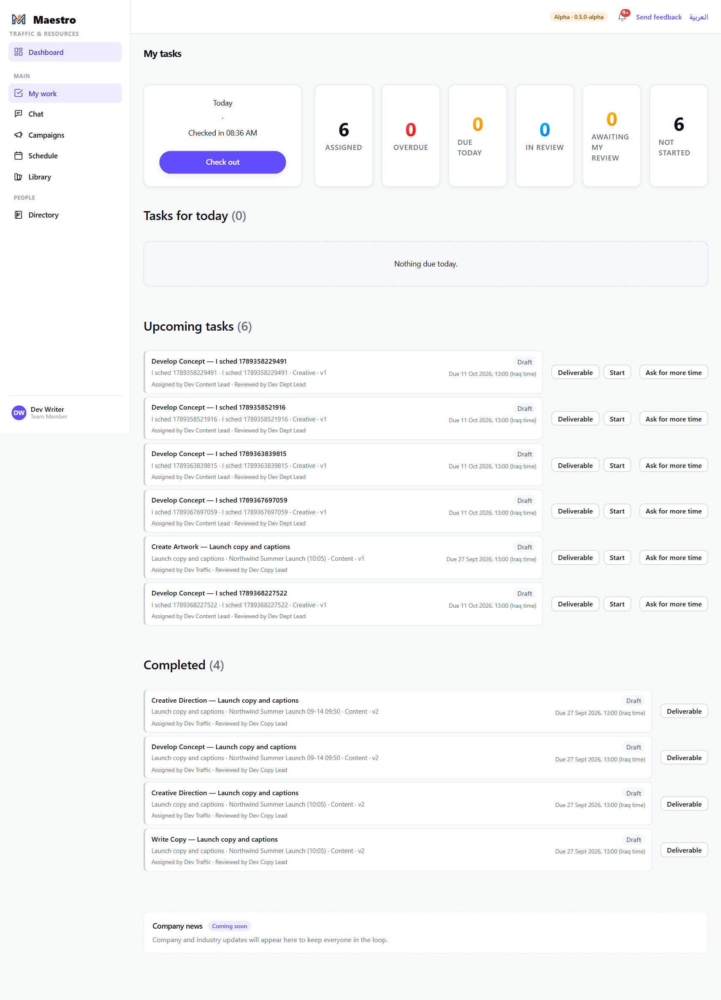
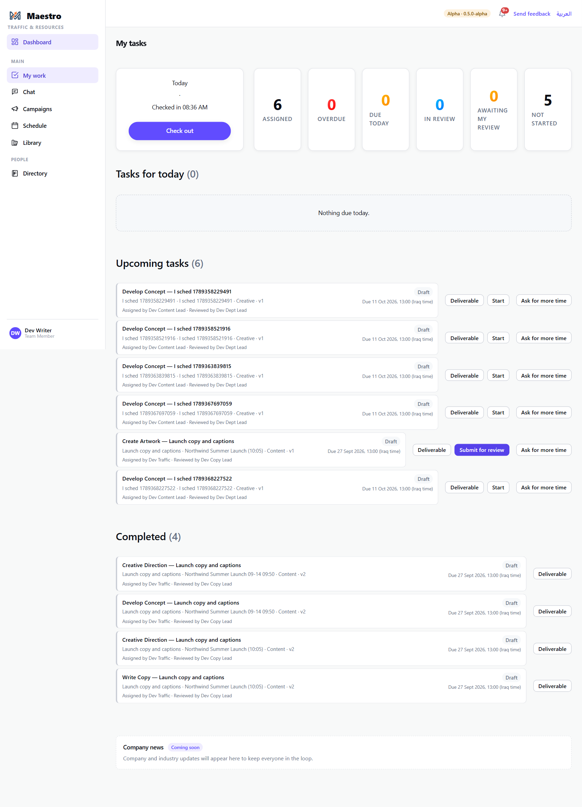
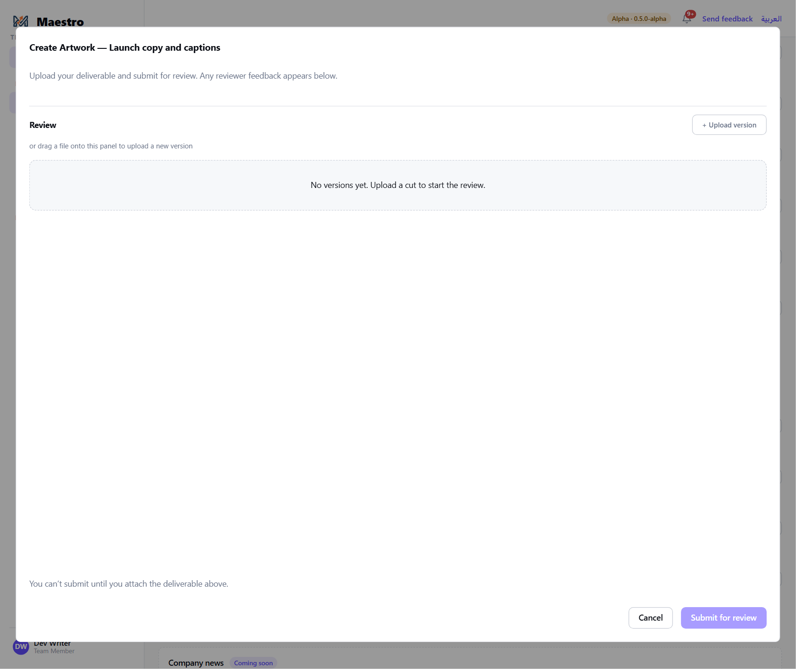
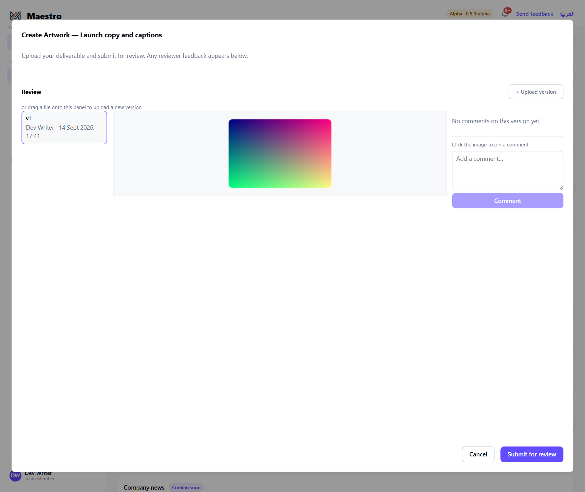
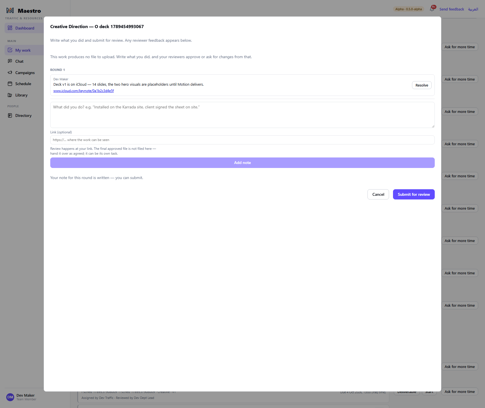
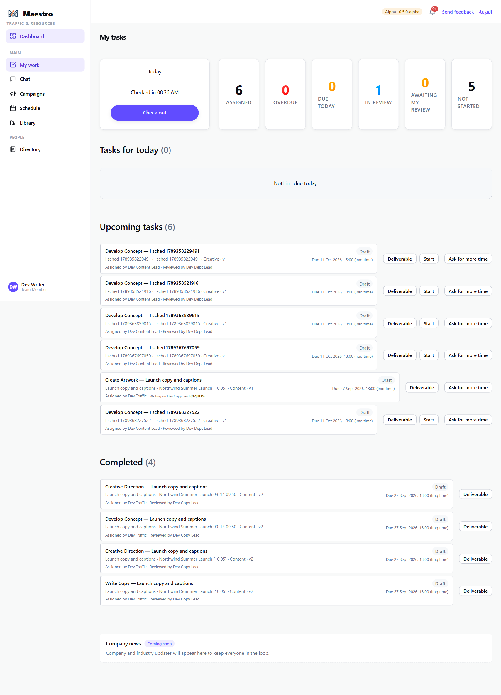
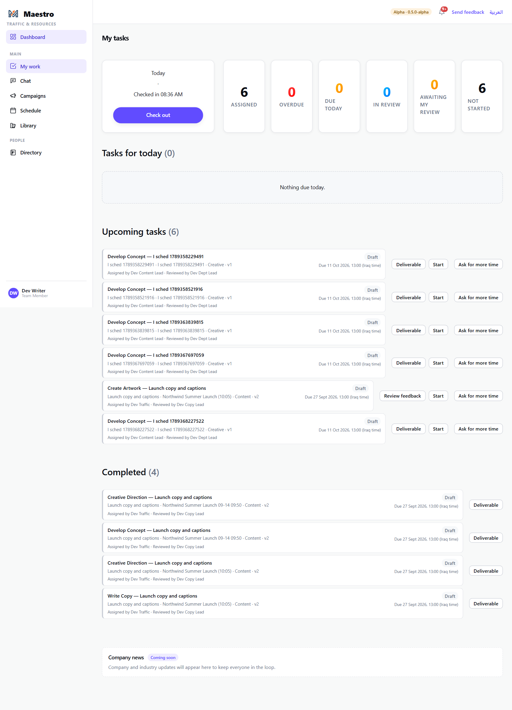
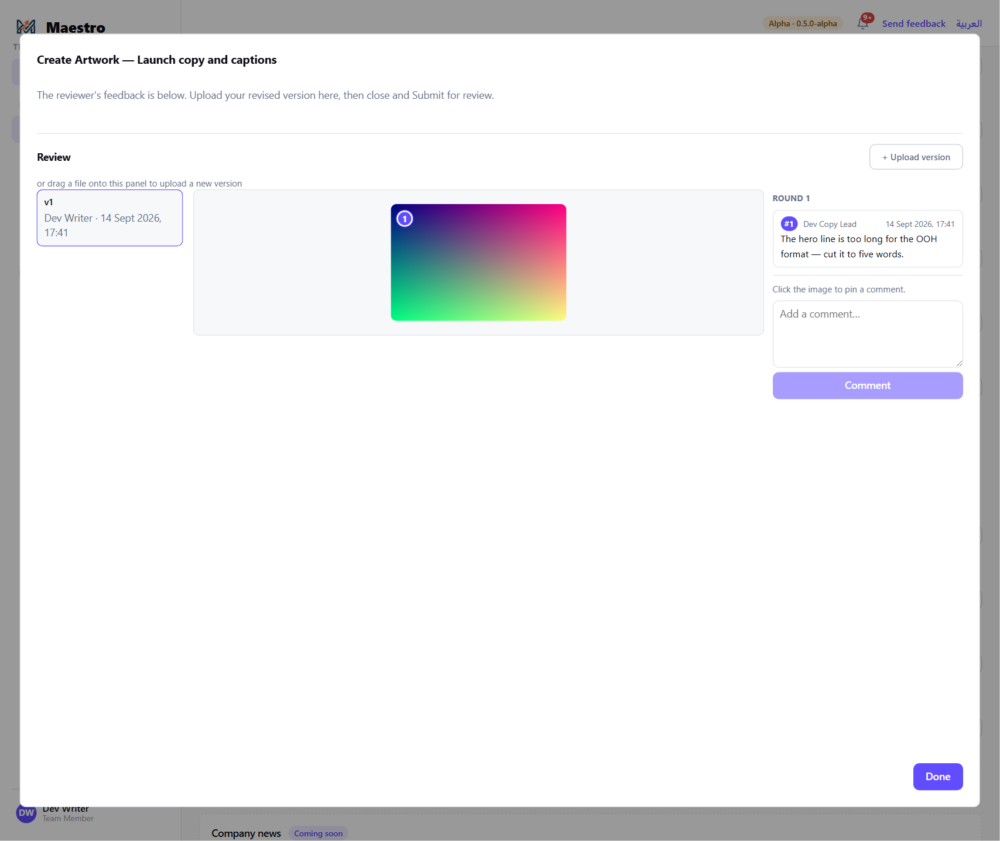
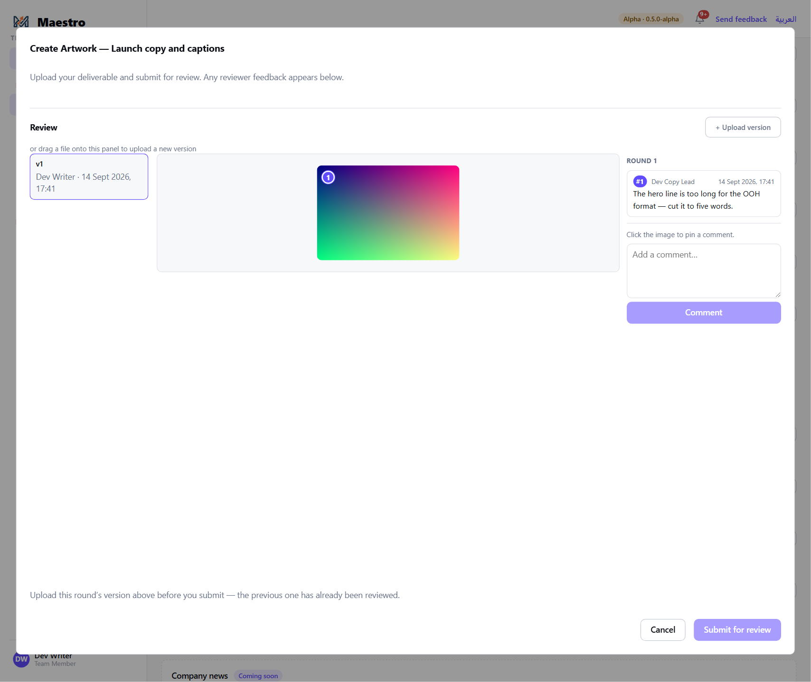
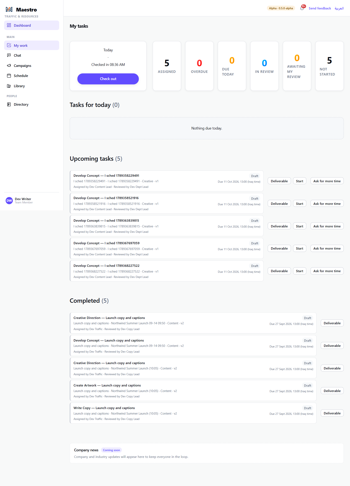

# 7 — Doing a task: My Work

**Who this is for:** everyone who is assigned work — designers, writers, editors, producers.

**My Work is your list.** Every task booked on your calendar is there, with who assigned it, who
reviews it, and when it is due. You **start** a task when you begin (a timer runs), **submit** it
when it is ready for review, and it comes back to you if the reviewer asks for changes. When the
required reviewer approves it, it moves to **Completed**.

**What you need before you start**

- A task assigned to you (your lead or Traffic booked it — guide 6). You were notified.
- For a **digital review** task: the file to hand over. For a **manual review** task (an
  installation, a shoot, anything that produces no file — or work that lives somewhere the system
  cannot reach, such as a Keynote on iCloud): a few lines on what you did, and a link if there is
  one.

---

## The steps

### 1. Open My Work

**My Work** in the sidebar. The top row counts your tasks: assigned, overdue, due today, in review,
awaiting *your* review (if you review others), not started. Below: **Tasks for today**, **Upcoming
tasks**, and **Completed**. **Check in / Check out** on the left is your attendance for the day.

Each task shows its deliverable and campaign, the version number, who assigned it and who reviews
it, and the due date in Iraq time. **Deliverable** opens the deliverable's own page. **Ask for
more time** raises a deadline extension request (guide 9).

### 2. Start

Press **Start** when you begin work. The task becomes *in progress*, a timer starts against it, and
the Start button becomes **Submit for review**.

Start it when you actually start — the timer is how your time on the task is recorded, and it is
what the SLA is measured against.

### 3. Submit for review

Press **Submit for review**. What the dialog asks for depends on the task's review mode:

**Digital review** — attach the file. Press **+ Upload version** or drag the file onto the panel.
Until a file is attached, Submit is greyed out: *"You can't submit until you attach the
deliverable above."*

Once uploaded, the file shows as **v1** with your name and the time. Press **Submit for review**.

**Manual review** — there is no file to upload. Write what you did in the note (*"Installed on the
Karrada site, client signed the sheet on site."*) and press **Add note**; Submit becomes available
once the note for this round is written.

If the work can be seen somewhere — a Keynote on iCloud, a shared drive, a staging page — paste
the address into **Link (optional)** before you press **Add note**. The reviewer gets it as a link
on your note. The note is still required: the link says where the work is, the note says what you
did. Review happens at your link; **the final approved file is not filed here** — hand it over as
agreed, and it can be its own task.

### 4. The task is in review

The task's status is *review*; the timer stops and your time is recorded. The reviewer is notified
and sees it under **Awaiting my review** on their own My Work. Nothing more is needed from you
until they answer.

### 5. If changes are requested

You are notified, and the task is back on your list with the version number moved on (**v2**) and
the button now reading **Review feedback**. Press it to see the reviewer's comments — pinned to the
exact spot on your file where each one applies, with the round they belong to.

Make the changes, then **Start** (the timer resumes for this round) and **Submit for review**
again. The dialog will not let you submit last round's file: *"Upload this round's version above
before you submit — the previous one has already been reviewed."* Attach the new version and
submit. It becomes **v2**; every version and every comment is kept.

### 6. Approved

When the required reviewer approves, the task moves to **Completed** and you are told. If it was the
last open task on the deliverable, the deliverable signs itself off — nobody has to do that
separately.

---

## The rules

- **Start before you submit.** Submit is only offered on a started task.
- **Digital review needs a file, every round.** After changes are requested, the previous version
  has been reviewed; you must upload this round's version before you can submit again.
- **Manual review needs a note, every round.** "What did you do?" — that is what the reviewer
  approves from. A link beside it is optional, and never replaces the note.
- **A link is not a file.** Nothing is filed, delivered or archived from it. The final approved
  file is handed over outside the review — as agreed, or as its own task.
- **You cannot move your own deadline.** Dragging is for whoever books you — your lead or
  Traffic; the committed date changes only through **Ask for more time**, which the account manager
  answers (guide 9).
- **What a task is waiting for** is shown on it (a client's files, a supplier's part). If yours
  says it is waiting on something, that is the reason it has not started — ask your lead, do not
  start the clock on it.
- **Reassignment.** If a task is moved to somebody else you are told; it leaves your list.

## What happens next

- The reviewer approves or requests changes (guide 8).
- Approved tasks stay under **Completed**. The deliverable's owner and the account manager see the
  deliverable's progress on its campaign page.
