# 8 — Reviewing a task: feedback, changes, approval

**Who this is for:** anyone named as a reviewer on a task — usually a team leader or department
lead, sometimes the account manager.

**What reviewing means here:** the assignee submitted a task (guide 7). You look at the version
they uploaded (or the note they wrote, for manual review), leave comments pinned to the file, and
either **request changes** — the task goes back to them for another round — or **approve** it.
Approval by the *required* reviewer completes the task. If it was the last open task on the
deliverable, the deliverable signs itself off.

**Required and optional reviewers.** Every task has exactly one **required** reviewer; there may
be optional ones — a second opinion from another lead, the account manager, a specialist. Whoever
books the task names them (guide 6): the first reviewer added is the required one, any others are
optional.

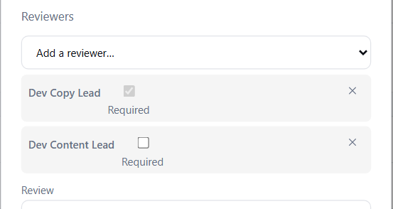

An optional reviewer **answers** — *Done — no comment*, or *Done — feedback left* once they have
commented. The required reviewer **approves**, and can only do so once every optional reviewer has
answered; the dialog says who is still to answer. If somebody is not going to answer, whoever
manages the task removes them from its reviewers, and the wait ends.

---

## The steps

### 1. Find what is waiting for you

**My Work → Awaiting my review** lists every task submitted to you, with who it is from. You were
also notified when it was submitted.

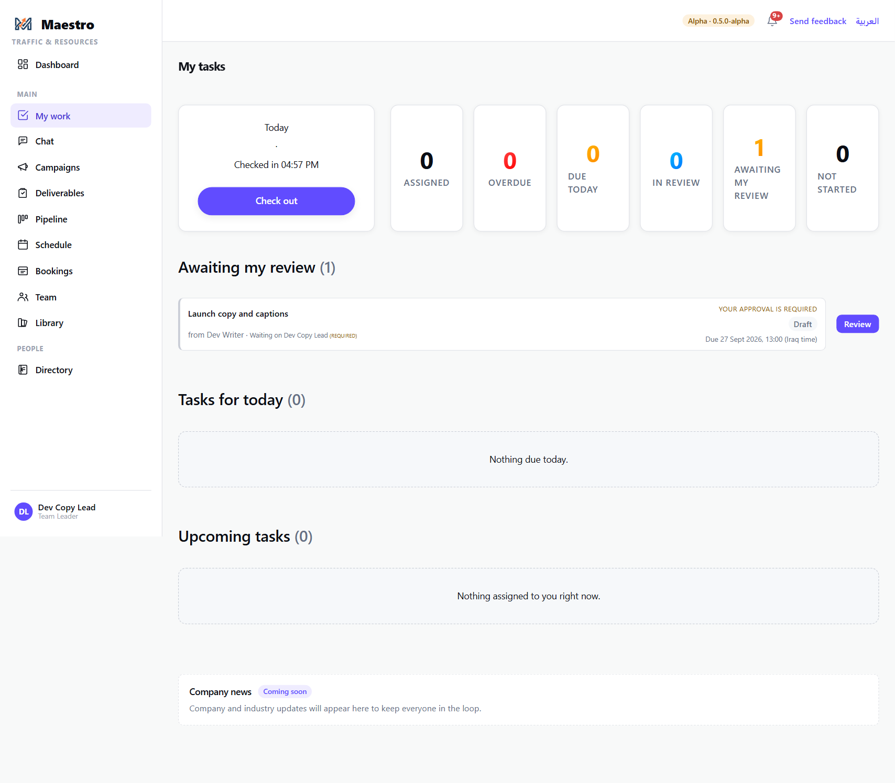

Press **Review** on the task.

### 2. Look at the version

The dialog names every reviewer and their standing — *(REQUIRED)*, *(NO ANSWER YET)* — then the
review panel: versions down the left (**v1**, **v2**…), the current version in the middle, comments
on the right, grouped by round.

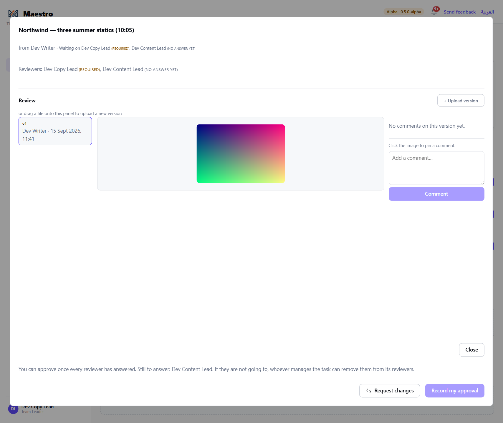

**Manual review** — there is no version. The dialog shows the maker's note instead, and, if they
gave one, a **link** under it to where the work can be seen (a Keynote on iCloud, a staging page).
Open it in the new tab, review there, and come back here to answer. The link is not a file: nothing
is filed from it, and the final approved file is handed over outside the review.

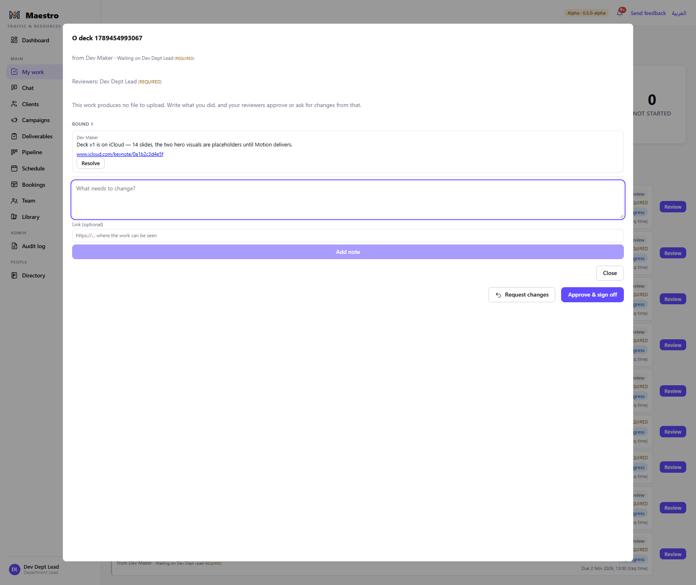

### 3. Leave feedback, pinned where it applies

**Click on the image** where the problem is. An **orange dot** drops — the pin is placed but not
yet posted — and the comment box says *Pinned — add your comment below*. Write the comment and
press **Comment**.

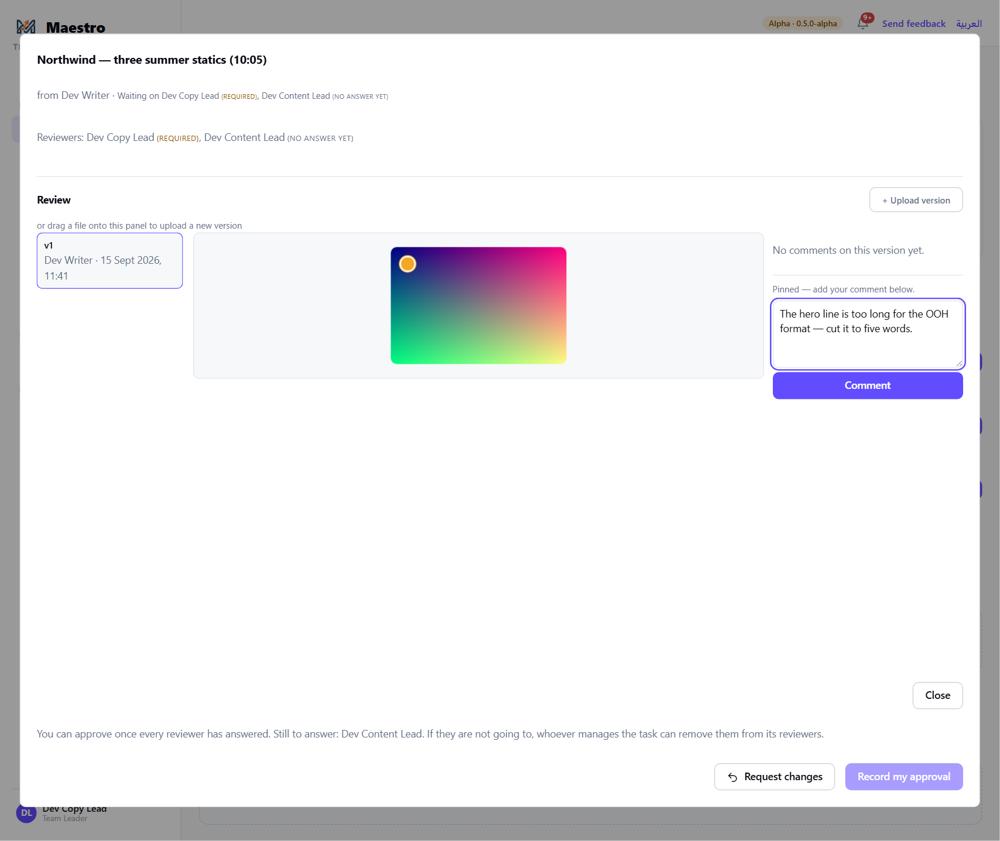

Once posted, the pin becomes a **numbered violet marker**, and the comment on the right carries the
same number — **#1** on the image is **#1** in the list. Each new pinned comment takes the next
number, so the reviewer and the maker are always talking about the same spot.

- **Resolve** a comment once it has been dealt with: its pin and its badge turn **grey**. **Reopen**
  brings it back.
- **Video:** pause where you mean; the comment is stamped with that moment. **Comment on the whole
  video** for a general note.
- **Documents and presentations** cannot be marked up in Maestro yet: download the file, read it
  in its own application, and say where you mean in the comment ("page 4, second paragraph").

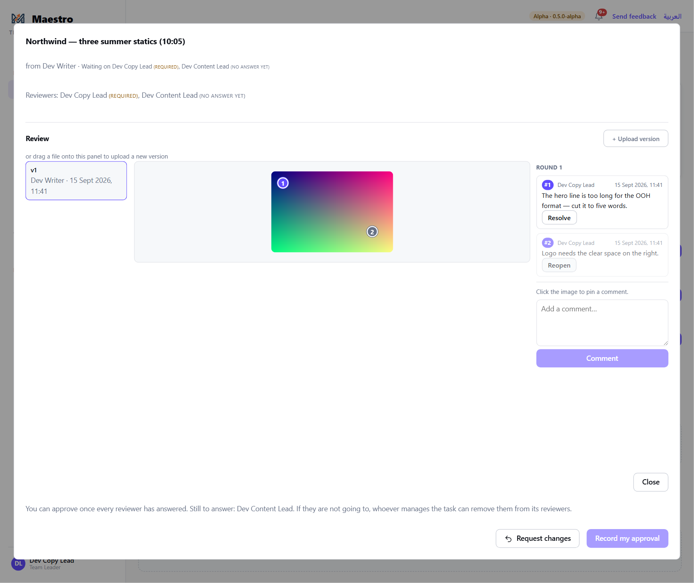

The colours, then: **orange** = placed, not posted · **violet with a number** = open · **grey** =
resolved.

### 4. One round: nothing is decided until every reviewer has answered

If the task has optional reviewers who have not answered, **both** decision buttons — *Request
changes* and *Approve* — are greyed out, and the line above them says why: *"You can approve or
request changes once every reviewer has answered — one round of feedback, not several. Still to
answer: Dev Content Lead."* You can still pin comments; they will all go back together.

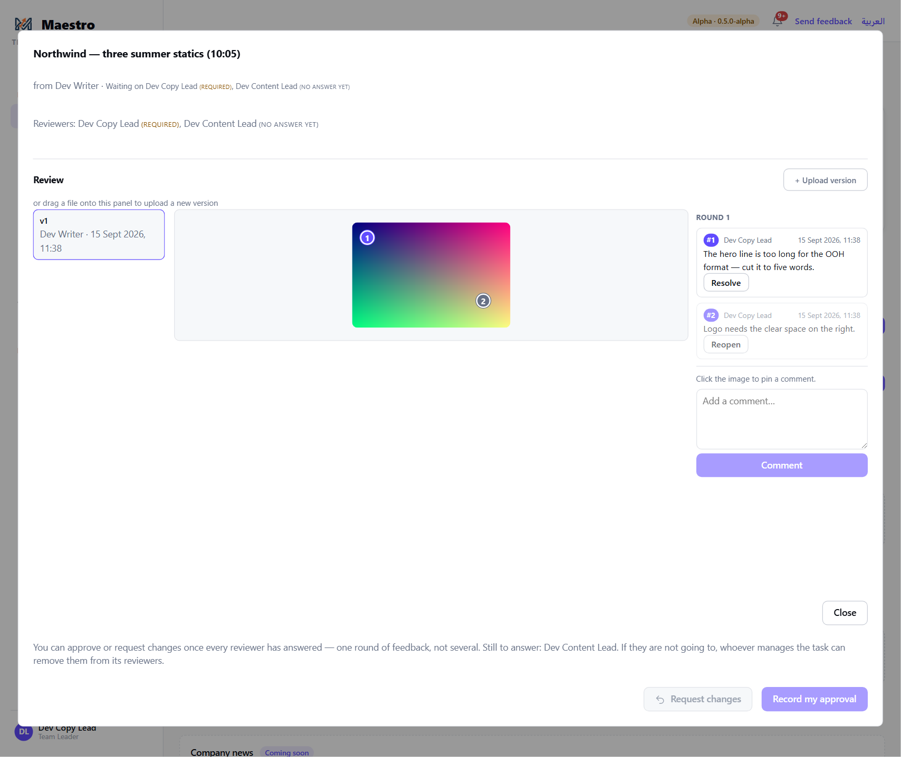

This is deliberate: the maker gets one consolidated round of feedback on each version, not a
send-back from each reviewer in turn.

### 5. The optional reviewer answers

The optional reviewer opens the same dialog from their own My Work. They see every pin and comment,
can add their own, and their button reads **Done — no comment** (or **Done — feedback left** once
they have commented). Pressing it records their answer; it does not approve anything. They can
also **Request changes** themselves — that counts as their answer — but only once every *other*
optional reviewer has answered too.

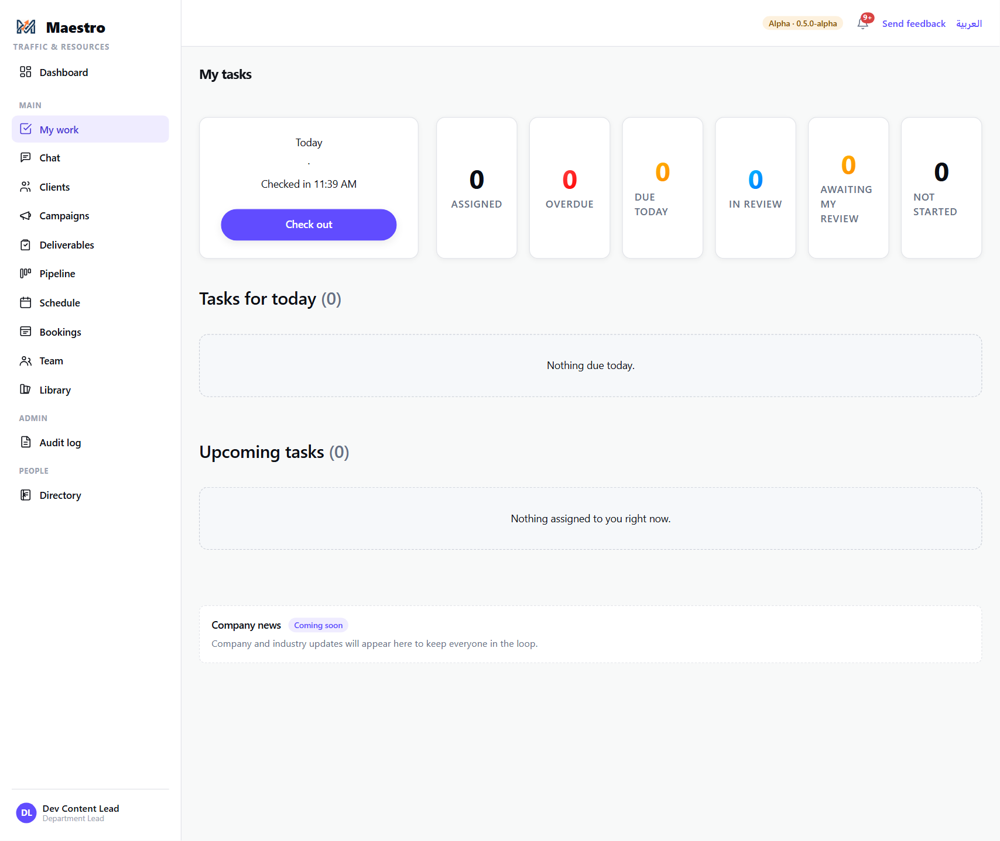

### 6. Decide

Back with the required reviewer, both buttons are live: the other reviewer now shows as
*answered*.

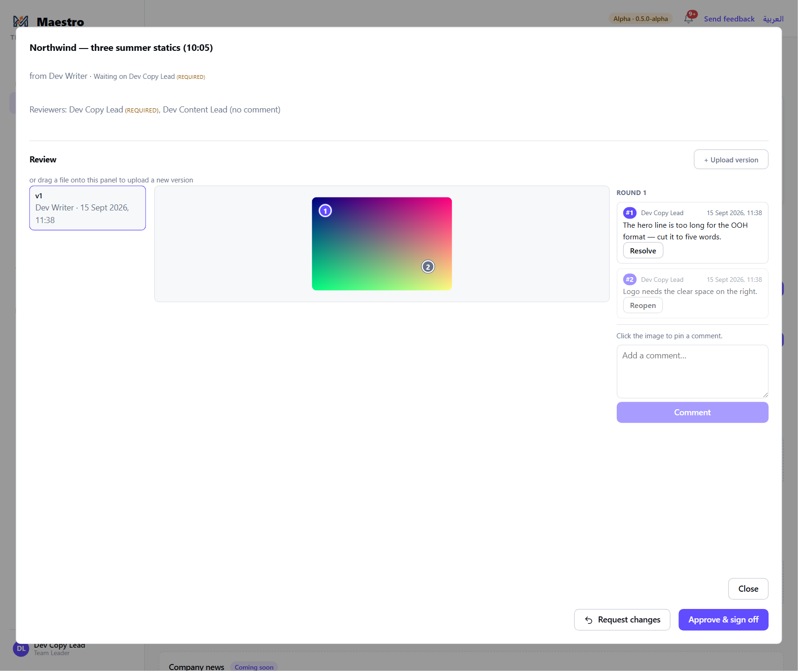

- **Request changes** — the task goes back to the assignee as *to do*; they are notified, they see
  every comment on the version, and the next round is timed separately. Any approvals or answers
  already recorded on this round are cleared, so the next version is reviewed afresh by everyone.
- **Approve & sign off** (or **Record my approval**, when there are several reviewers) — the
  task is *done*; the assignee is told. If every other task on the deliverable is done, the
  deliverable is signed off.

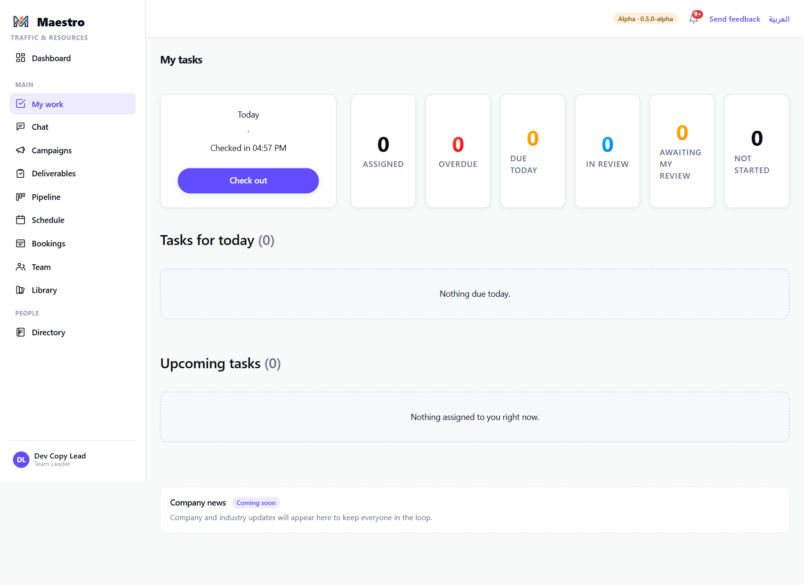

### 7. The next round

When the assignee resubmits, the task is back under **Awaiting my review** with the new version
selected (**v2**). Earlier versions and their comments stay in the list on the left, so you can
check that what you asked for was done — the pins on v1 are still there.

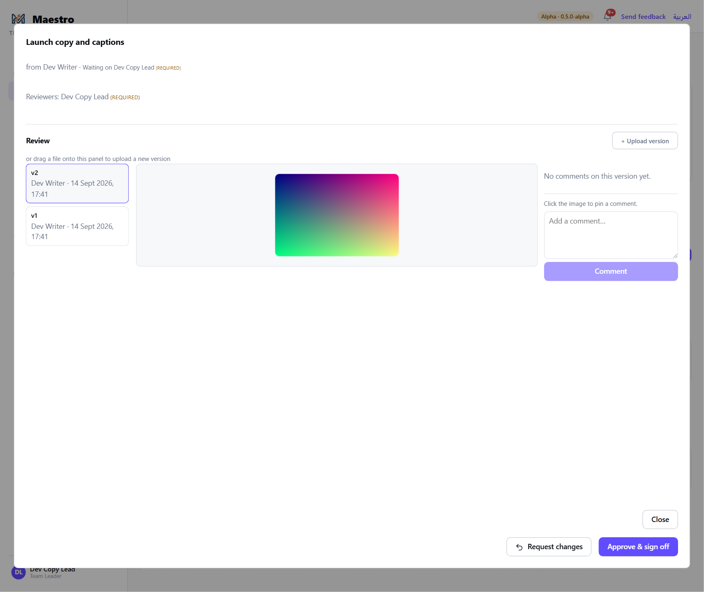

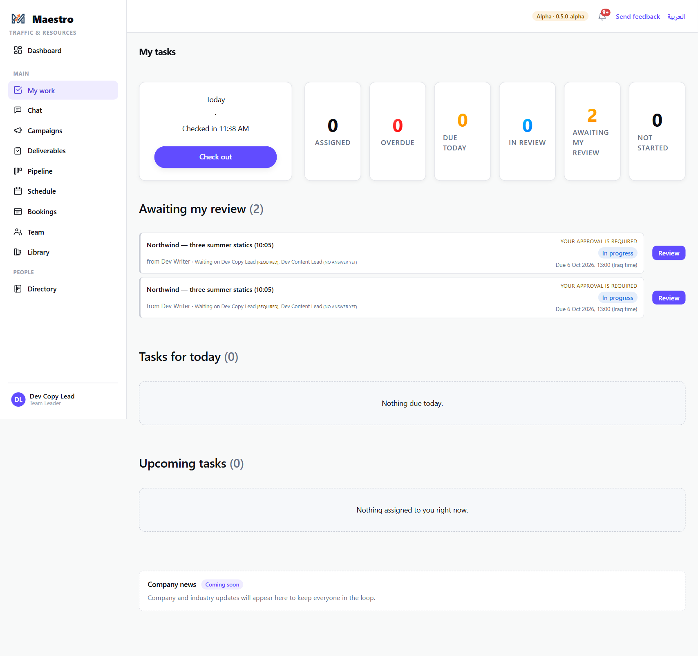

---

## The rules

- **Only the task's named reviewers review it.** Being a lead or a moderator is not enough; you
  must be on the task. Whoever books the task adds reviewers then, or from the task list.
- **Exactly one reviewer is required.** The required reviewer's approval completes the task.
  Optional reviewers cannot approve; they answer.
- **The required approval waits for every answer.** The dialog names who is outstanding; removing
  a reviewer who will not answer is the way out, and only whoever manages the task can do it.
- **A send-back waits too.** Request changes, like approval, is available only once every optional
  reviewer has answered — one consolidated round per version. The reviewer pressing it does not
  wait for their own answer. It clears the round: approvals and answers on the returned version
  are wiped, and the next version is reviewed afresh by everyone.
- **Pins are numbered and colour-coded** — orange while unposted, violet with a number once
  posted, grey when resolved — and the number on the image is the number on the comment.
- **Every version and every comment is kept.** Nothing is overwritten; each round adds to the
  record.
- **You cannot approve before the assignee submits.** *"Waiting for the assignee to submit before
  you can sign off."*
- **Sign-off is automatic.** Approving the last task closes the deliverable. Nobody signs off a
  deliverable by hand.

## What happens next

- **Approved:** the task is under the assignee's Completed; the deliverable's progress updates on
  the campaign page. When all its tasks are done the deliverable is signed off and the account
  manager can mark it delivered and, when the campaign is finished, close the campaign out
  (guide 10).
- **Changes requested:** the assignee uploads the next version and submits again (guide 7).
