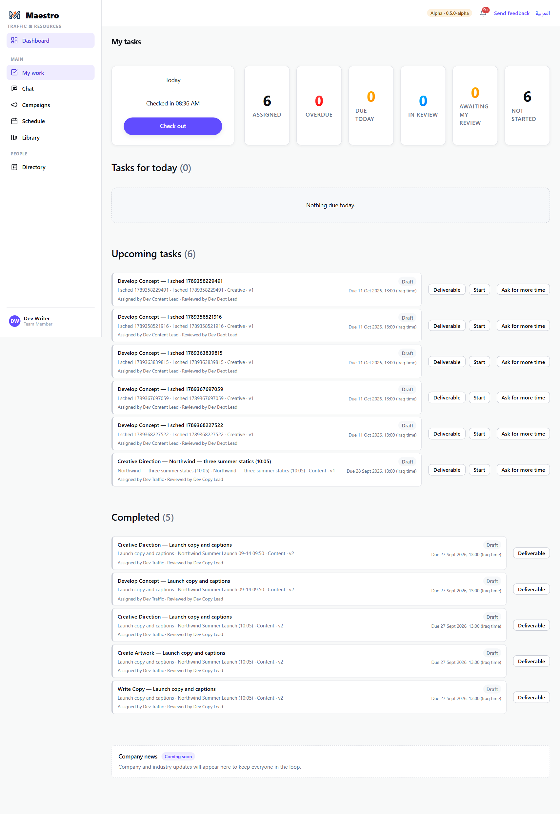
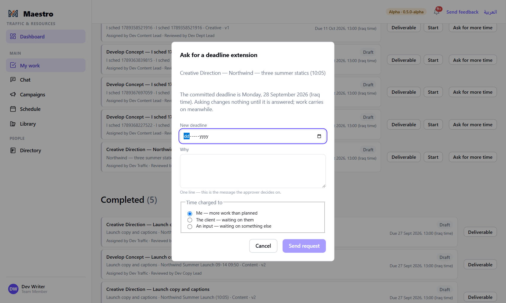
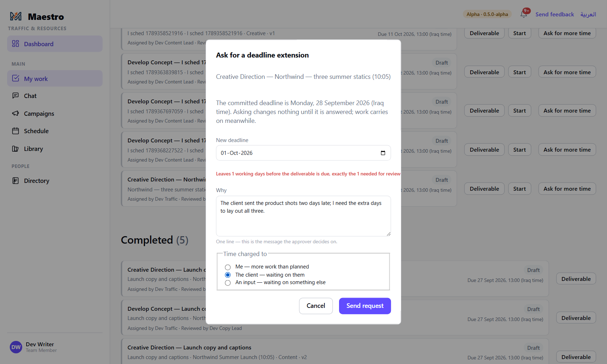
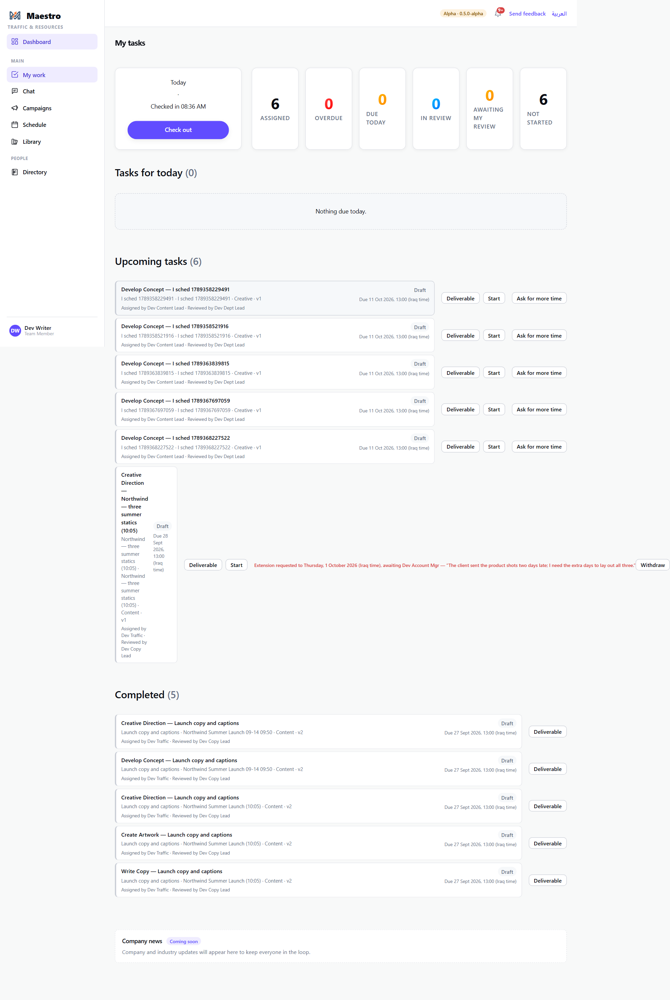
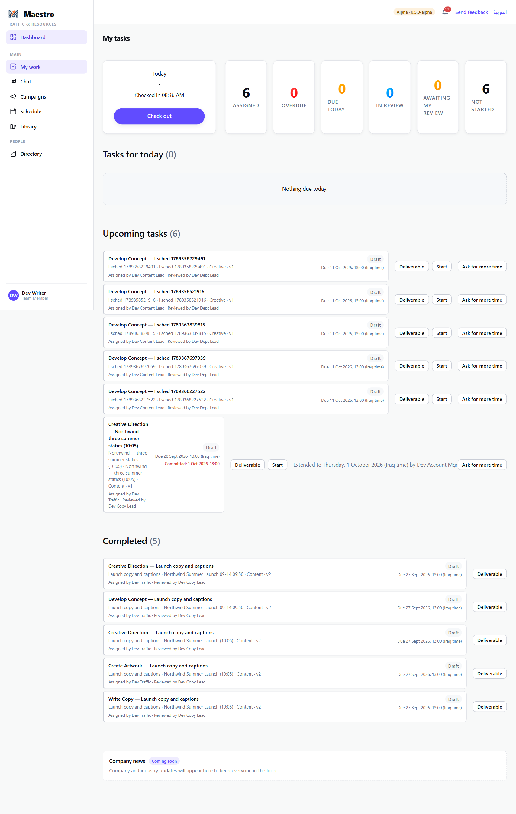
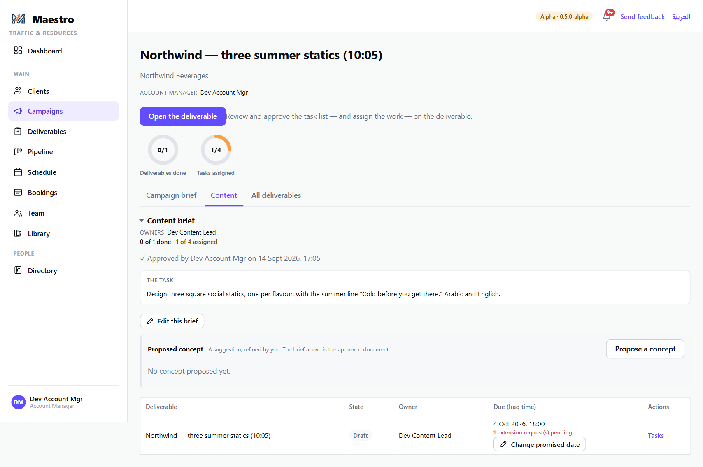
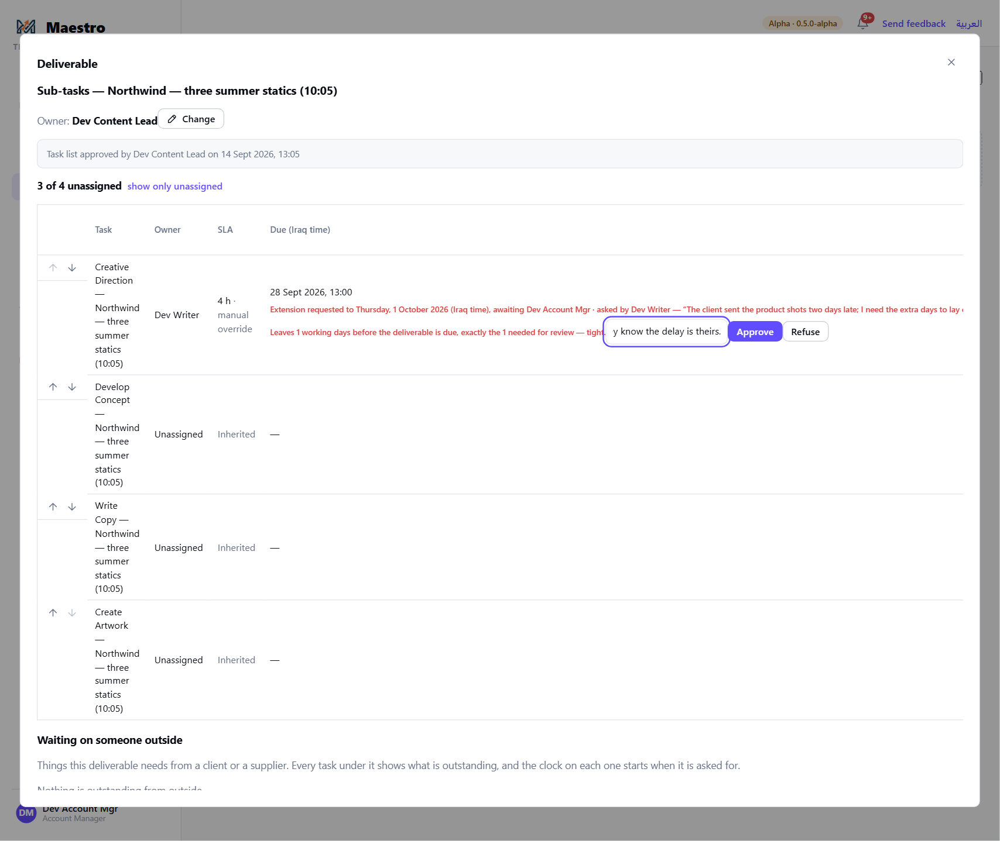
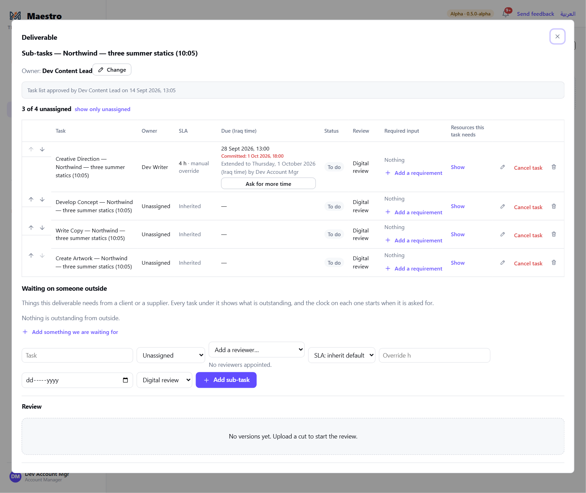
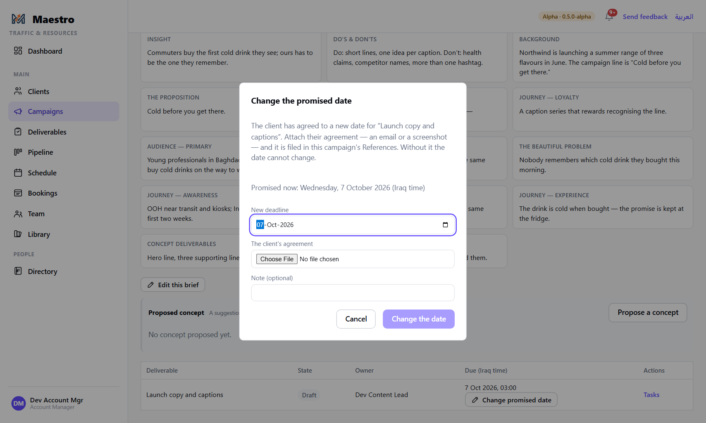
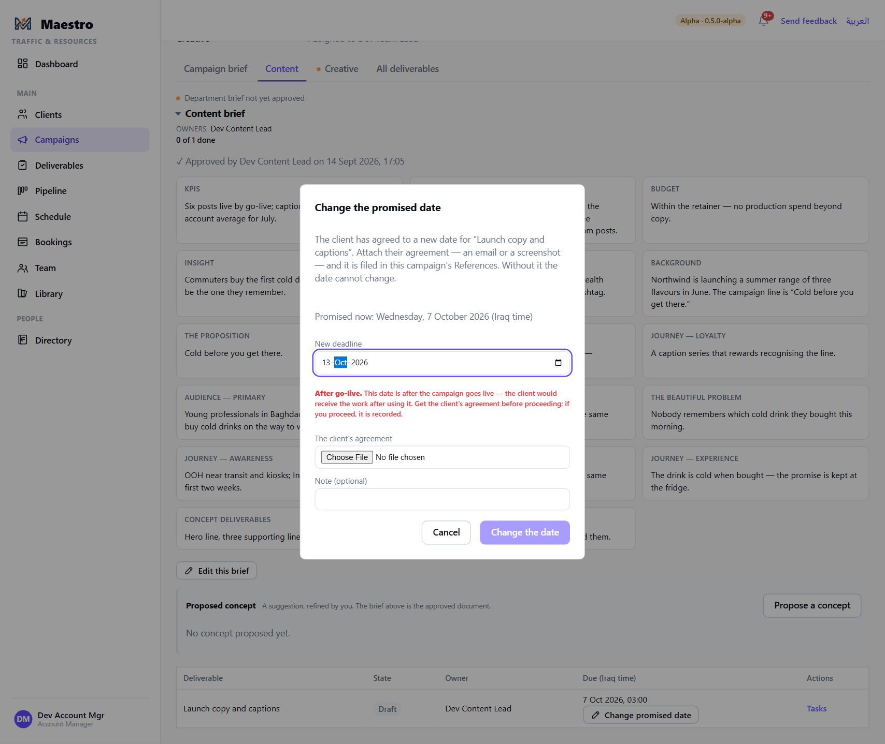

# 9 — Deadlines: asking for more time, and changing the promised date

**Who this is for:** everyone who does work (asking), the Account Manager (answering, and changing
the client's promised date), and Traffic (standing in).

**Three dates, and which one moves.** Every task has a **plan** — the booking on the schedule, which
whoever books it can drag — and a **commitment** — the deadline the assignee was given when the task was
assigned. Dragging the plan never touches the commitment; that is what stops a missed deadline from
quietly deleting itself. The commitment moves only by **asking**, and the account manager answering.
Above both sits the deliverable's **promised date** — the date given to the client — which only the
account manager changes, with the client's agreement on file.

---

## Part A — Asking for more time (the assignee)

### 1. Ask from My Work

Every live task on **My Work** has **Ask for more time**. It is also on the task inside the
deliverable, for anyone who could reschedule the task.

### 2. Say when, why, and whose time it is

- **New deadline** — the day you are asking for. As you type it, a line under the field does the
  arithmetic against the deliverable's promised date: *fine*, *tight* (exactly the review buffer
  left), *at risk* (less than the review buffer), *after go-live* (the client's agreement will be
  needed), or *past the deliverable's own due date*.
- **Why** — one line. This is the message the approver decides on.
- **Time charged to** — **Me** (more work than planned), **The client** (waiting on them), or
  **An input** (waiting on something else). This is the record of whose time was lost.

Press **Send request**. Nothing changes yet — the dialog says so: *"Asking changes nothing until
it is answered; work carries on meanwhile."*

### 3. While it is pending

The task's row shows *Extension requested to … awaiting [the account manager]*, with **Withdraw**
if you change your mind. Keep working to the original date.

When it is answered the line changes to *Extended to … by …* or *Extension to … refused by …*,
and you are notified.

---

## Part B — Answering (the account manager)

### 4. Find the request

You are notified. On the **campaign page**, the deliverable's row shows *1 extension request
pending*. Press **Tasks** to open the deliverable.

### 5. Decide on the task

On the task's row, under its due date: the request — to when, asked by whom, their reason — and the
same arithmetic the assignee saw. Add a **note** if you want, then **Approve** or **Refuse**.

**Approving moves the committed deadline only.** The plan on the schedule stays where it is —
the lead or Traffic moves the booking if it needs moving — and nothing about the work pauses.

---

## Part C — Changing the promised date (the account manager)

### 6. Open the door

The promised date is the client's date on the deliverable. It changes only here: on the campaign
page, a department tab, the deliverable's row → **Change promised date**. You must be the campaign's
account manager (Traffic and the Power Admin can stand in), and the campaign must be approved.

### 7. New date, the client's agreement, a note

- **New deadline**. Under it, the same warnings as the Campaign Builder's timing step: *Tight*,
  *Impossible as planned* (with the hours outstanding against the hours the remaining days can
  hold), or *After go-live*. **None of them stops you** — proceed, and the override is recorded with
  your name.
- **The client's agreement** — attach the email or screenshot. It is filed in the campaign's
  References. **Without it the date cannot change.**
- **Note** (optional).

Press **Change the date**.

---

## The rules

- **The commitment moves only by asking and approving.** Dragging on the schedule, or re-dating
  the task in a dialog, moves the plan. When such a move ends after the commitment, the dialog
  *offers* to raise a request in the same save — it never forces one.
- **Who may ask:** the assignee, and anyone who could reschedule the task.
- **Who answers:** the campaign's account manager. Traffic and the Power Admin can answer in
  their place — the record says they stood in.
- **A second request supersedes the first;** both are kept. A refusal moves nothing. A finished
  task's request is not pending.
- **The promised date needs evidence.** No agreement on file, no change.
- **A date after go-live is never refused, anywhere** — wizard, promised-date dialog, extension
  request. It warns, names the client's agreement, and records who accepted it. Past go-live an
  extension is asked for like any other; the account manager decides, and may refuse.
- **Everything is recorded** — the request, the reason, whose time, the decision and its note, and
  every date override — against the task or deliverable, with the person's name.

## What happens next

- Approved: the assignee is told; the committed date on the task and on My Work updates. If the
  booking also needs to move, the lead or Traffic drags it (guide 6).
- Refused: the assignee is told, with your note; the original deadline stands.
- Promised date changed: the deliverable's due date updates on every list and the override is on
  its record.
