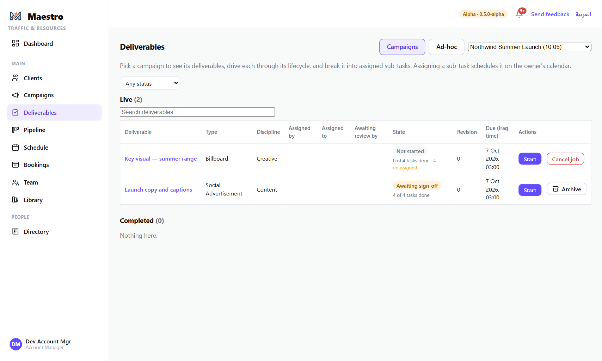
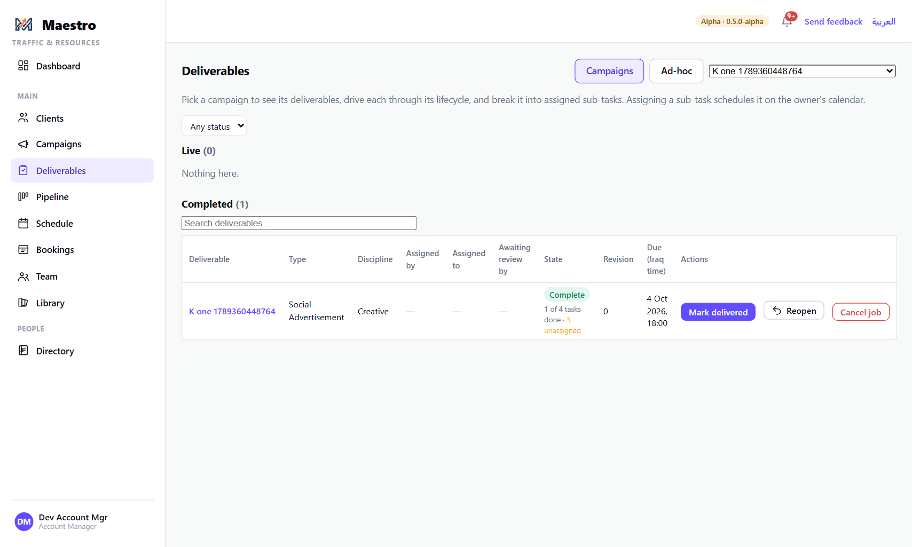
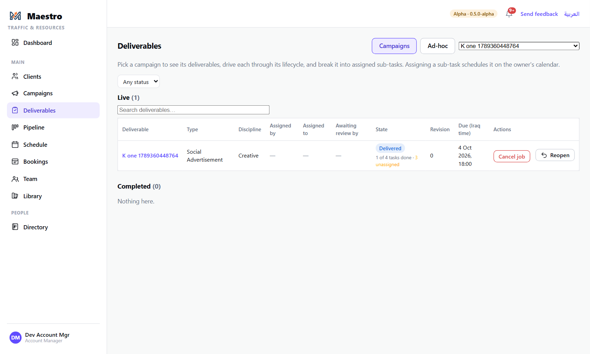
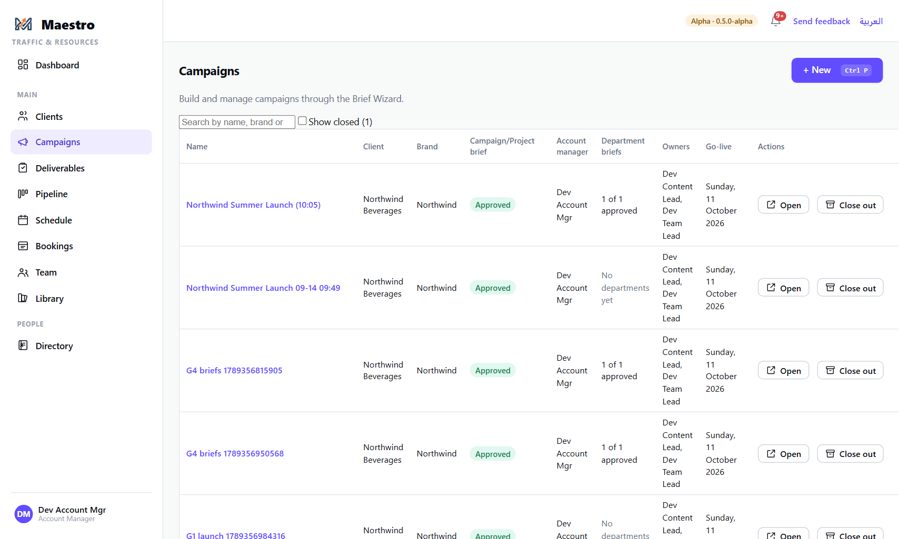
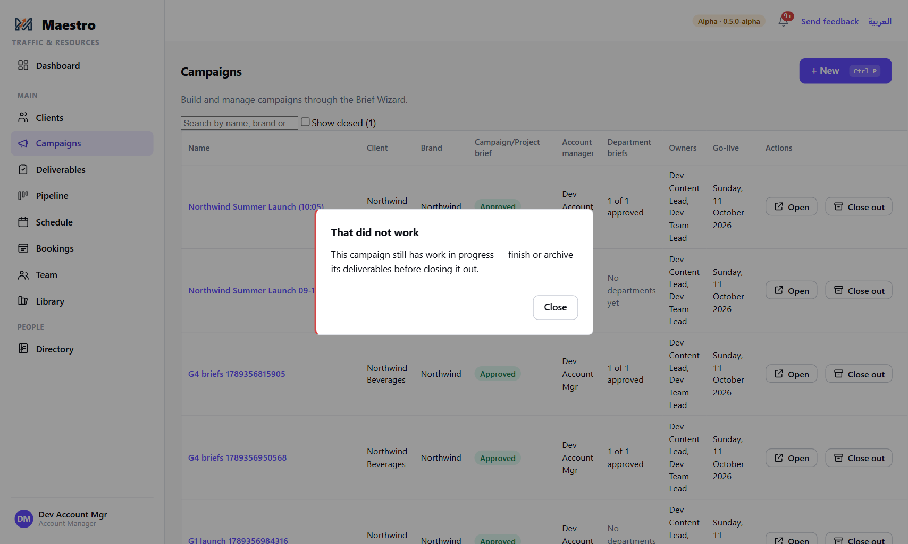

# 10 — Finishing: sign-off, delivery, and closing a campaign out

**Who this is for:** the Account Manager, the deliverable's owner, and Traffic.

**The shape of the end.** Tasks are approved by their reviewers (guide 8). When the last task under
a deliverable is approved, the deliverable is **signed off** by itself. The account manager then
**marks it delivered** when the client has it. When every deliverable on a campaign is finished,
the campaign is **closed out** — it leaves the working lists and stays on the record.

---

## The steps

### 1. The deliverable starts itself

A deliverable begins as **Draft**. The moment anyone presses **Start** on any task under it, it
becomes **In progress** — nobody has to start the container. (Its row on **Deliverables** still has
**Start**, for marking a deliverable under way before any task has begun.)

### 2. Sign-off is automatic

When the required reviewer approves the last open task, the deliverable's state becomes
**Approved**. Nobody presses anything for this; it is the consequence of decisions already made,
task by task. Its row moves to **Completed** on the assignees' My Work, and the campaign page's
*Deliverables done* count moves.

### 3. Mark delivered

When the client has received the work, the account manager (or Traffic) presses **Mark
delivered** on the deliverable's row. The state becomes **Delivered**.

### 4. Close the campaign out

On **Campaigns**, an approved campaign's Actions column has **Close out**.

If any deliverable on it is still open, Maestro refuses: *"This campaign still has work in
progress — finish or archive its deliverables before closing it out."* Finish them, or archive the
ones that will never happen, then close out.

A closed campaign leaves the list. **Show closed** at the top brings closed campaigns back, each with
**Reopen** — closing out is reversible.

*(Screenshot withheld from the public copy: Closed campaigns, and Reopen)*

### 5. Archiving and cancelling — the other endings

- **Cancel a task** (the deliverable's task list) — releases its booking, tells the assignee; its
  record is kept if work had started, removed if nobody had ever been given it.
- **Cancel job / Archive** on a deliverable — calls off every task under it that is not already done
  or cancelled, the same way, and archives the container. A *done* task survives, being the
  record of what happened. Archived is final.
- **Reopen** a delivered or approved deliverable if work has to resume; **Unblock** one that was
  blocked.

---

## The rules

- **Tasks are approved; deliverables are signed off.** Different verbs, different people:
  reviewers approve tasks, and sign-off follows from the last approval with no authority of its
  own.
- **In progress means work has begun.** The first Start on any of a deliverable's tasks moves it
  out of Draft; the deliverable's own Start button is only for marking it under way earlier.
- **Delivered is a person's act.** Nothing marks a deliverable delivered automatically; the
  account manager says the client has it.
- **Close-out is refused while work is open** and is reversible with **Reopen**.
- **Archiving is not reversible**, and it calls off live work — the surface warns before it does.
- **Nothing is deleted from the record.** Cancelled tasks that had started, archived deliverables
  and closed campaigns all stay readable.

## What happens next

- The assignee is told when their task is signed off; the owner and account manager see the
  deliverable's state on the campaign page and the Pipeline.
- Delivered files are filed against the campaign in the Library (Final Assets) as that part of the
  system is completed; today the final file is uploaded there by hand.
