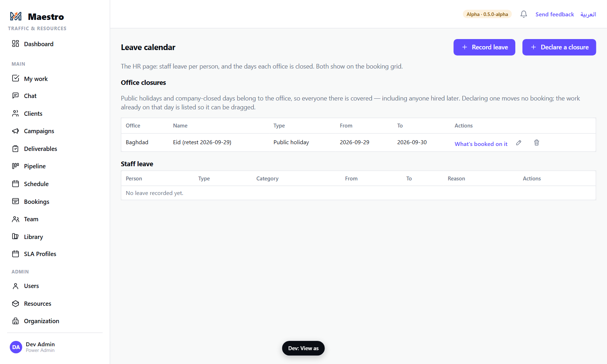
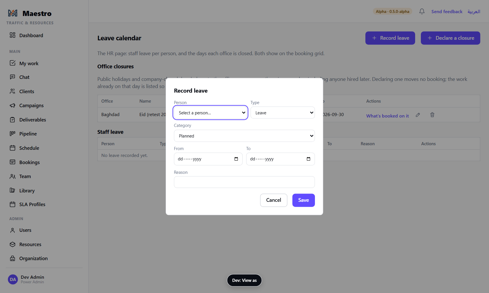
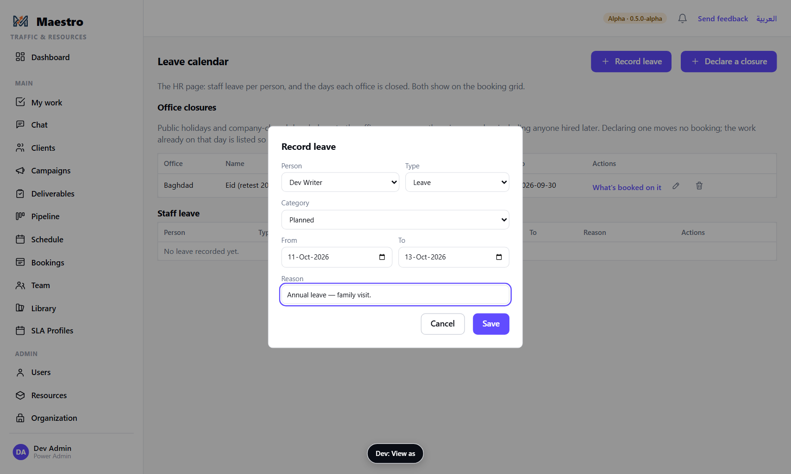
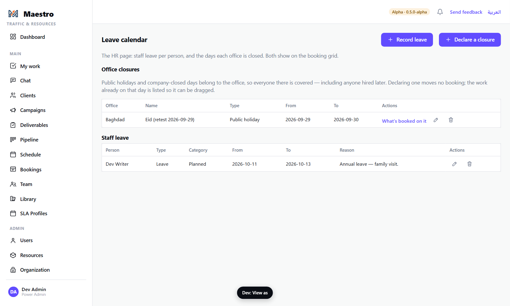
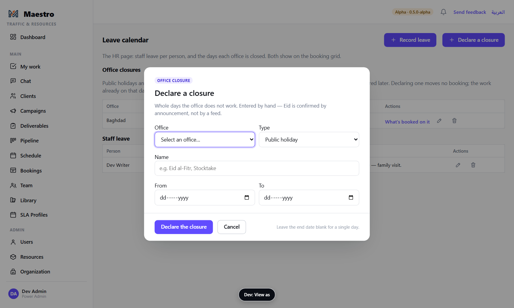
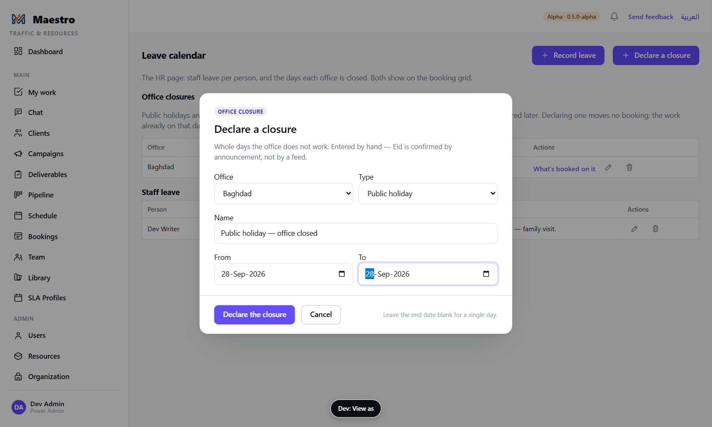
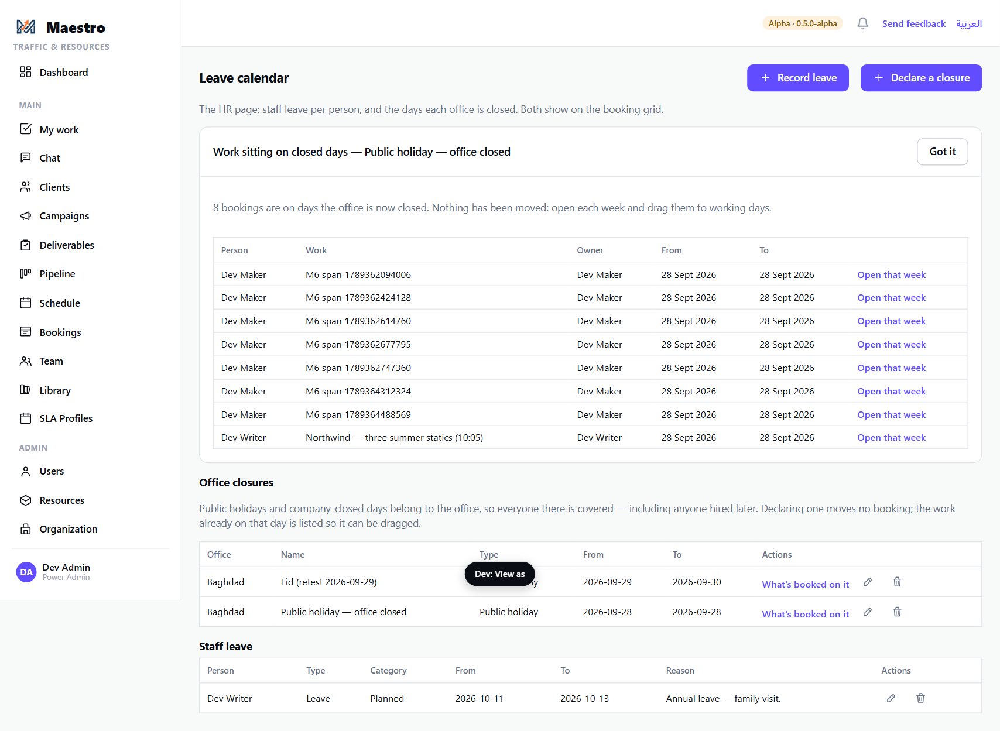
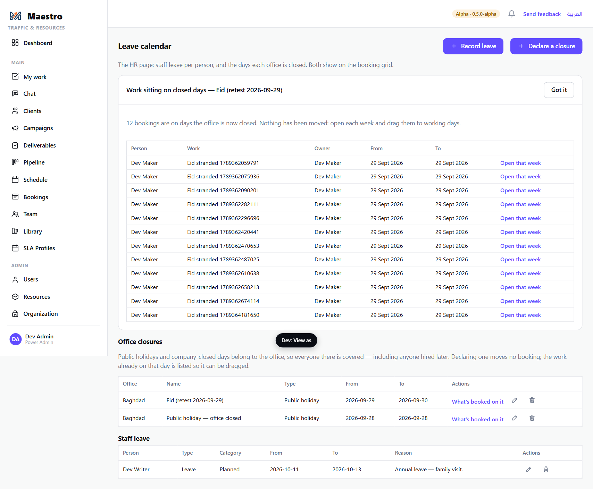
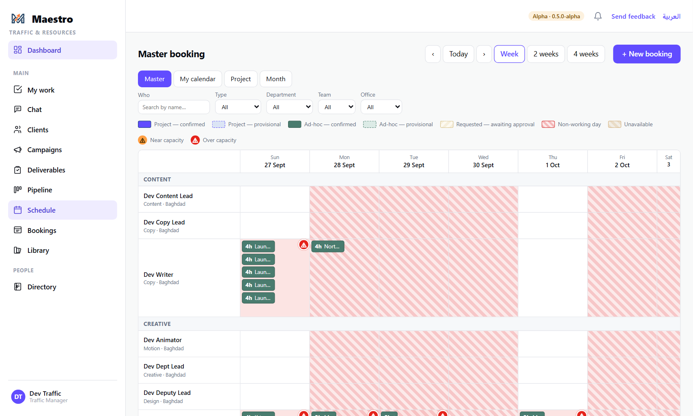

# 11 — Leave and office closures

**Who this is for:** whoever holds the leave permission — today the Power Admin; later, HR.
Everyone who books sees the result on the schedule.

**Two different things on one page.** **Staff leave** belongs to a person: their days off, one
entry per person per absence. **Office closures** belong to an office: a public holiday or a
company-closed day covers everyone in that office, including people hired after it was declared.
Both show on the booking grid, and both are skipped when Maestro counts working days for due dates
and extension arithmetic.

**What you need before you start**

- For leave: who, from when to when, and the category (planned, emergency, sick, unpaid).
- For a closure: which office, what it is called, the dates. Eid is confirmed by announcement, not
  by a feed — you enter it by hand when it is known.

---

## The steps

### 1. Open the Leave calendar

**People → Leave**. Office closures are listed first, then staff leave.

### 2. Record leave for a person

Press **+ Record leave**.

- **Person** — anyone bookable.
- **Type** — Leave. (*Holiday* is a legacy option; public holidays are declared on the office
  now, see step 3.)
- **Category** — Planned, Emergency, Sick, Unpaid.
- **From / To** — whole days. The end cannot be before the start.
- **Reason** — optional.

Press **Save**. The entry is in the Staff leave table, and on the schedule those days are hatched
*Unavailable* for that person.

### 3. Declare an office closure

Press **+ Declare a closure**.

- **Office** — which office is closed.
- **Name** — *Eid al-Fitr*, *Stocktake*.
- **Type** — Public holiday or Company closed.
- **From / To** — leave the end blank for a single day.

Press **Declare the closure**.

### 4. Work sitting on the closed days

Declaring a closure **moves no booking**. Anything already booked on those days is listed straight
away in a panel at the top of the page — *Work sitting on closed days* — with the person, the work,
its owner and the dates. Each row has **Open that week**, which opens the schedule on the right
week so the booking can be dragged to a working day. The same list is behind **What's booked on
it** on the closure's row, any time later.

### 5. On the schedule

The closed days are hatched for everyone in that office. A booking dragged onto one warns (*Not
a working day for them*) and asks **Move it anyway?**; a new booking on one warns the same way.

### 6. Changing and removing

The pencil edits an entry or a closure; the bin deletes, asking once. Deleting a closure makes
its days working days again; nothing that was moved off them moves back.

---

## The rules

- **Leave stays with the person's own lead.** Booking work on somebody's calendar is open to every
  lead and account manager (guide 6); recording their leave is not — that is their own department
  lead's or team leader's act, or People & Culture's. A lead who can put a Production editor on a
  task still cannot record the editor's leave (ADR-0098 d.3).

- **Leave is per person; a closure is per office.** Declaring a holiday on the office is what
  covers everyone — do not enter it person by person.
- **Nothing moves automatically.** A closure lists the work sitting on it; the leads or Traffic
  move it. A person's leave does not move their bookings either — the grid shows the clash.
- **Working-day arithmetic skips closures** — the go-live offsets in the Campaign Builder, the
  extension arithmetic, the *Commence by* and *Due by* dates — so a date that lands on a closed day
  is stepped over, never onto it.
- **Who may manage leave:** the leave permission — the Power Admin today. Where the stranded-work
  list lives (HR's page, or Traffic's schedule) is decided when an HR role exists.

## What happens next

- The leads or Traffic drag stranded bookings to working days (guide 6); each affected assignee
  is told when their booking moves.
- The Dashboard's load figures and the Team page reflect the reduced working days.
