# Notification emails — as actually sent (17 Sep 2026, third pass — the decided words)

**What this is.** One real email per notification type, produced by the product on the local stack
on 17 Sep 2026 and captured from Mailpit — not a template, not a table of placeholders. Every image
is the mail as the recipient's client renders it. Under each image: the subject line, the sentence,
the facts line, the button, and **what filled the name** — read from the notification row itself.

**Third pass — the decided words.** Edward went through the actions one at a time on 17 Sep
(`notification-email-copy.md`, "Decided one action at a time"): who each mail is for, and what is
now required of them, with real names and dates. These samples are the product sending those
words. Two earlier faults are fixed underneath them: a single job's deliverable is named after what
was picked (`I52.1`), and a reinstated task is announced to the people who can assign it (`I52.7`).
Two types are gone — `blocked` (nothing ever raised it) and `brief_awaiting_approval` (folded into
Action 1) — and three are new: the old owner, the person a task was taken from, the optional
reviewer.

**How the name is built.** The subject and the sentence carry one name, joined at send time from two
stored columns (`src/lib/notifications/label.ts`, I30.7):

> **campaign — work**

- *campaign* is the campaign or job the thing sits in (`notifications.context_label`).
- *work* is what the event is about (`notifications.label`): for a task it is the **task's title**;
  for a deliverable, the **deliverable's name**; for a campaign, the campaign's name (and then no
  prefix, so it is not repeated).
- A task's title is composed at creation as **step — deliverable** (ADR-0071 d.10). A task added by
  hand keeps the name it was given (`Mail task`, `Cov added task v2` below).

**The facts line** (grey, under the sentence) is generated from the work: the due date on the Iraq
clock, and the hours — nothing else. It is not written per type. When the work has neither, the line
is absent.

**The button** says *Open in Maestro*. The assignee's own events open **My Work**; deliverable
events open the deliverable inside its campaign; booking requests open the **schedule** on the day
with that person searched; an extension to answer and a task to assign open **the task itself**.

**Test data names.** Every name carries a number (`K two 1789619686384`) because the suite stamps
its fixtures so runs do not collide. Read it as *"K two"*.

---

## `campaign_approved`

**To:** the deliverable’s owner — nobody else (Action 1). **When:** the account manager approved the campaign or released the single job.

### English

| | |
|---|---|
| **Subject** | Approved: P3 report 1789641076806 |
| **Sentence** | Dev Account Mgr approved P3 report 1789641076806. You need to review the brief and tasks and then approve so each task can be assigned. |
| **Facts** | Sunday 4 October 2026 (Iraq time) |
| **Button** | *Open in Maestro* → `/deliverables?campaign=2a448843-094e-44f4-9583-bee1be99d685&open=59d1dea5-8f5e-43cf-b849-1e71c54af68c` |
| **campaign** | `P3 report 1789641076806` |
| **work** (deliverable) | `Social Advertisement` |

## `deliverable_reassigned`

**To:** the NEW owner (Action 2). **When:** somebody with authority changed the deliverable’s owner.

### English

| | |
|---|---|
| **Subject** | Assigned to you: F creative 1789640765711 — Social Advertisement |
| **Sentence** | Dev Dept Lead made you the owner of Social Advertisement on F creative 1789640765711. You need to review the brief and tasks and then approve so each task can be assigned. |
| **Facts** | Sunday 4 October 2026 (Iraq time) |
| **Button** | *Open in Maestro* → `/deliverables?campaign=39ec8795-1ebb-4998-b312-808eb63c09ff&open=e9d6ec76-9f7c-4688-84e4-8d69e698777f` |
| **campaign** | `F creative 1789640765711` |
| **work** (deliverable) | `Social Advertisement` |

## `deliverable_owner_removed`

**To:** the OLD owner, one line (Action 2). **When:** the same change.

### English

| | |
|---|---|
| **Subject** | No longer yours: F production 1789640766837 — TV Advertisement |
| **Sentence** | TV Advertisement on F production 1789640766837 is now owned by Dev Edit Lead. |
| **Facts** | *(none — the work has no date or hours)* |
| **Button** | *Open in Maestro* → `/deliverables?campaign=baeb4040-05ca-4069-823b-435d90bf8655&open=644d6b3e-3443-4424-ac57-57e3b393f074` |
| **campaign** | `F production 1789640766837` |
| **work** (deliverable) | `TV Advertisement` |

## `assigned`

**To:** the person assigned (Action 3). **When:** a task was assigned to them — the Schedule, the add-task picker, an approved booking request, Reinstate-and-assign.

### Arabic

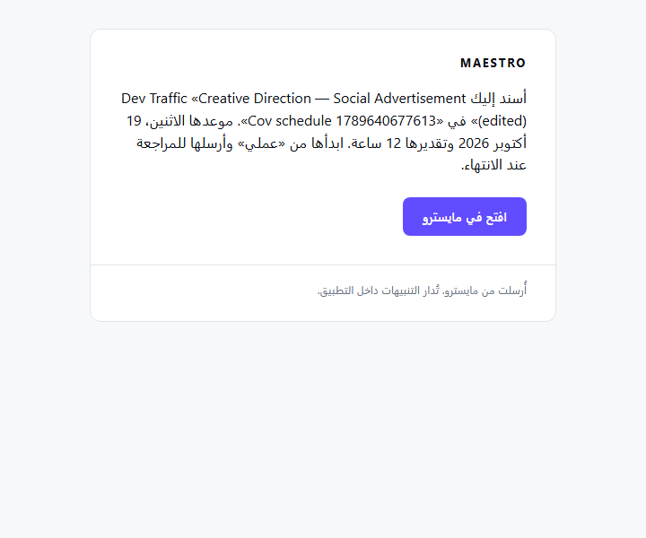

| | |
|---|---|
| **Subject** | مهمة جديدة: Creative Direction — Social Advertisement (edited) |
| **Sentence** | أسند إليك Dev Traffic «Creative Direction — Social Advertisement (edited)» في «Cov schedule 1789640677613». موعدها الاثنين، 19 أكتوبر 2026 وتقديرها 12 ساعة. ابدأها من «عملي» وأرسلها للمراجعة عند الانتهاء. |
| **Facts** | *(none — the work has no date or hours)* |
| **Button** | *افتح في مايسترو* → `/my-work?task=ddcd81e4-cda5-47fc-b4e0-870c8eed90f7` |
| **campaign** | `Cov schedule 1789640677613` |
| **work** (sub_task) | `Creative Direction — Social Advertisement (edited)` |

### English

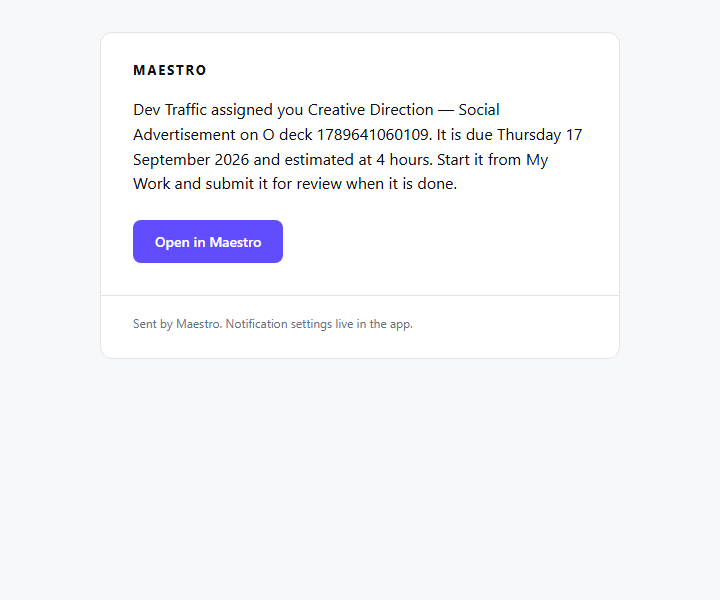

| | |
|---|---|
| **Subject** | New task: Creative Direction — Social Advertisement |
| **Sentence** | Dev Traffic assigned you Creative Direction — Social Advertisement on O deck 1789641060109. It is due Thursday 17 September 2026 and estimated at 4 hours. Start it from My Work and submit it for review when it is done. |
| **Facts** | *(none — the work has no date or hours)* |
| **Button** | *Open in Maestro* → `/my-work?task=46943125-6b40-44e6-b59d-2050d16ea56f` |
| **campaign** | `O deck 1789641060109` |
| **work** (sub_task) | `Creative Direction — Social Advertisement` |

### English · no campaign (ad-hoc / single deliverable)

| | |
|---|---|
| **Subject** | New task: Eid stranded 1789641041050 |
| **Sentence** | Dev Team Lead assigned you Eid stranded 1789641041050. It is due Thursday 8 October 2026 and estimated at 2 hours. Start it from My Work and submit it for review when it is done. |
| **Facts** | *(none — the work has no date or hours)* |
| **Button** | *Open in Maestro* → `/my-work?task=f80100a4-04dd-4930-b8af-e42246648d8a` |
| **campaign** | *(none)* |
| **work** (sub_task) | `Eid stranded 1789641041050` |

## `task_reassigned_away`

**To:** the person the task was taken from (Action 3). **When:** their task was reassigned to somebody else.

### Arabic

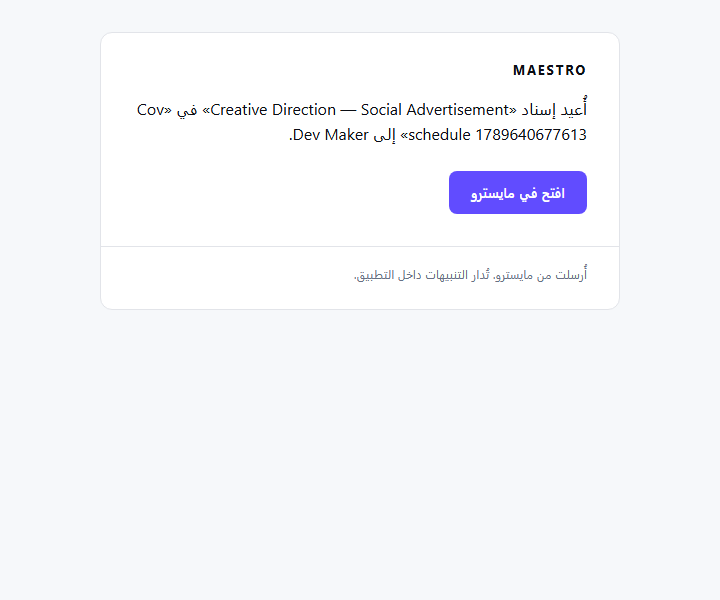

| | |
|---|---|
| **Subject** | لم تعد لك: Creative Direction — Social Advertisement |
| **Sentence** | أُعيد إسناد «Creative Direction — Social Advertisement» في «Cov schedule 1789640677613» إلى Dev Maker. |
| **Facts** | *(none — the work has no date or hours)* |
| **Button** | *افتح في مايسترو* → `/my-work?task=ddcd81e4-cda5-47fc-b4e0-870c8eed90f7` |
| **campaign** | `Cov schedule 1789640677613` |
| **work** (sub_task) | `Creative Direction — Social Advertisement` |

### English

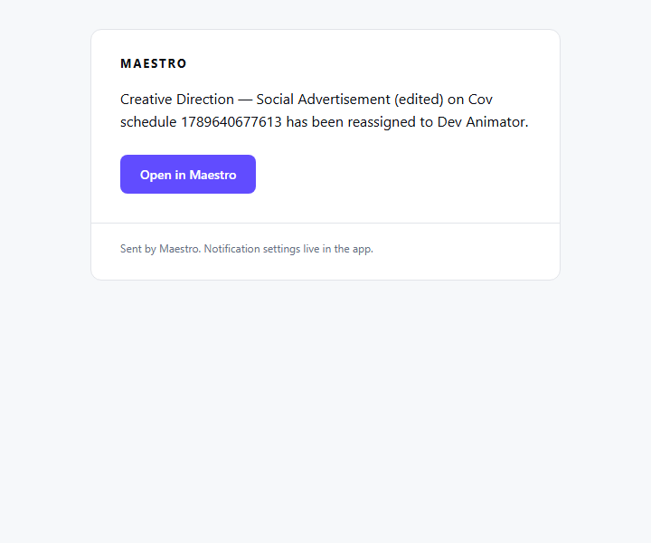

| | |
|---|---|
| **Subject** | No longer yours: Creative Direction — Social Advertisement (edited) |
| **Sentence** | Creative Direction — Social Advertisement (edited) on Cov schedule 1789640677613 has been reassigned to Dev Animator. |
| **Facts** | *(none — the work has no date or hours)* |
| **Button** | *Open in Maestro* → `/my-work?task=ddcd81e4-cda5-47fc-b4e0-870c8eed90f7` |
| **campaign** | `Cov schedule 1789640677613` |
| **work** (sub_task) | `Creative Direction — Social Advertisement (edited)` |

## `review_requested`

**To:** each REQUIRED reviewer (Action 4). **When:** the maker submitted the task for review.

### English

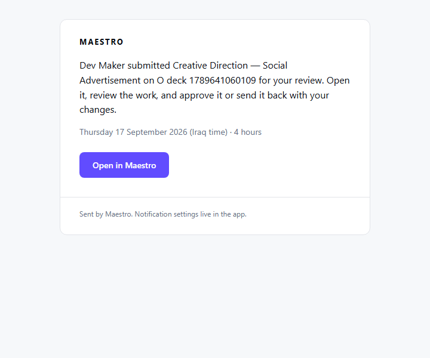

| | |
|---|---|
| **Subject** | Review needed: Creative Direction — Social Advertisement |
| **Sentence** | Dev Maker submitted Creative Direction — Social Advertisement on O deck 1789641060109 for your review. Open it, review the work, and approve it or send it back with your changes. |
| **Facts** | Thursday 17 September 2026 (Iraq time) · 4 hours |
| **Button** | *Open in Maestro* → `/my-work?task=46943125-6b40-44e6-b59d-2050d16ea56f` |
| **campaign** | `O deck 1789641060109` |
| **work** (sub_task) | `Creative Direction — Social Advertisement` |

## `feedback_requested`

**To:** each OPTIONAL reviewer (Action 4). **When:** the maker submitted the task for review.

### English

| | |
|---|---|
| **Subject** | Your feedback is needed: Develop Concept — Social Advertisement |
| **Sentence** | Dev Traffic submitted Develop Concept — Social Advertisement on J review 1789640862415. Open it and leave your feedback, or mark it “no comment” — the approval waits for your answer. |
| **Facts** | Monday 2 November 2026 (Iraq time) · 4 hours |
| **Button** | *Open in Maestro* → `/my-work?task=cddfc0e5-234e-47aa-acb1-e973971387f8` |
| **campaign** | `J review 1789640862415` |
| **work** (sub_task) | `Develop Concept — Social Advertisement` |

## `changes_requested`

**To:** the assignee (Action 5). **When:** a reviewer sent the task back — the feedback is pointed to, never carried.

### English

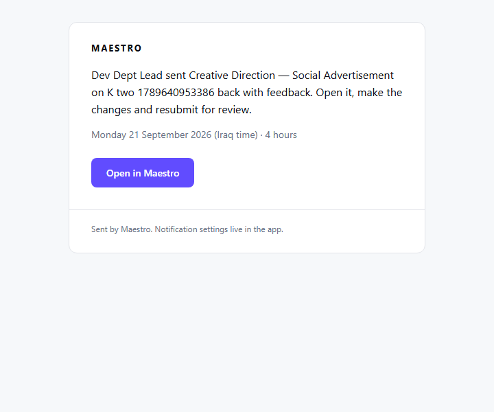

| | |
|---|---|
| **Subject** | Changes requested: Creative Direction — Social Advertisement |
| **Sentence** | Dev Dept Lead sent Creative Direction — Social Advertisement on K two 1789640953386 back with feedback. Open it, make the changes and resubmit for review. |
| **Facts** | Monday 21 September 2026 (Iraq time) · 4 hours |
| **Button** | *Open in Maestro* → `/my-work?task=024f800d-edd7-485f-aa57-fd36fe45047d` |
| **campaign** | `K two 1789640953386` |
| **work** (sub_task) | `Creative Direction — Social Advertisement` |

## `signed_off`

**To:** the assignee (Action 6a). **When:** the required reviewer approved the task.

### English

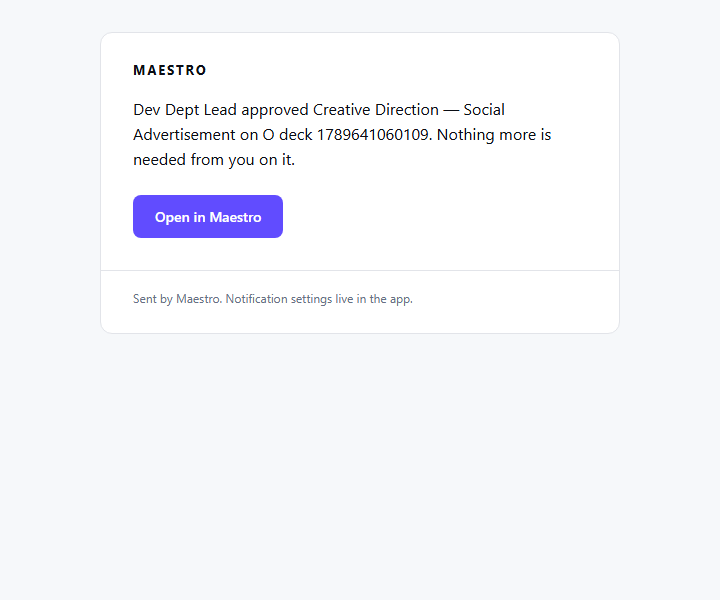

| | |
|---|---|
| **Subject** | Approved: Creative Direction — Social Advertisement |
| **Sentence** | Dev Dept Lead approved Creative Direction — Social Advertisement on O deck 1789641060109. Nothing more is needed from you on it. |
| **Facts** | *(none — the work has no date or hours)* |
| **Button** | *Open in Maestro* → `/my-work?task=46943125-6b40-44e6-b59d-2050d16ea56f` |
| **campaign** | `O deck 1789641060109` |
| **work** (sub_task) | `Creative Direction — Social Advertisement` |

## `cancelled`

**To:** the assignee (Action 7). **When:** their task was cancelled — Cancel, Remove-with-history, or the job archived.

### English

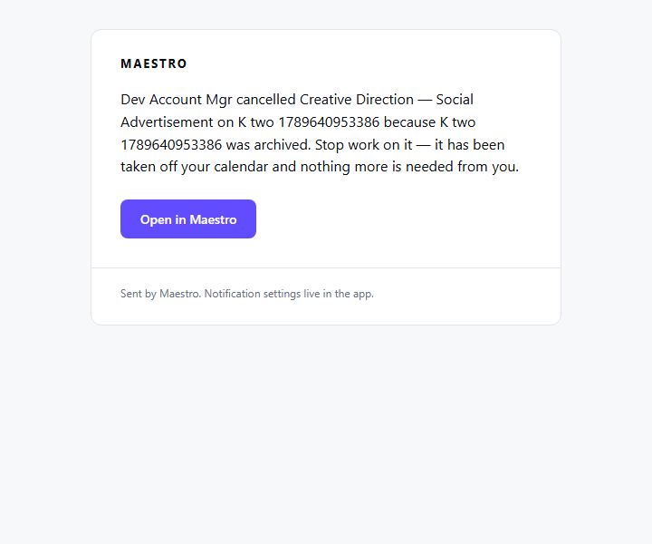

| | |
|---|---|
| **Subject** | Cancelled: Creative Direction — Social Advertisement |
| **Sentence** | Dev Account Mgr cancelled Creative Direction — Social Advertisement on K two 1789640953386 because K two 1789640953386 was archived. Stop work on it — it has been taken off your calendar and nothing more is needed from you. |
| **Facts** | *(none — the work has no date or hours)* |
| **Button** | *Open in Maestro* → `/my-work` |
| **campaign** | `K two 1789640953386` |
| **work** (sub_task) | `Creative Direction — Social Advertisement` |

## `rescheduled`

**To:** the assignee (Action 8). **When:** their booking was dragged to different days on the Schedule.

### English · no campaign (ad-hoc / single deliverable)

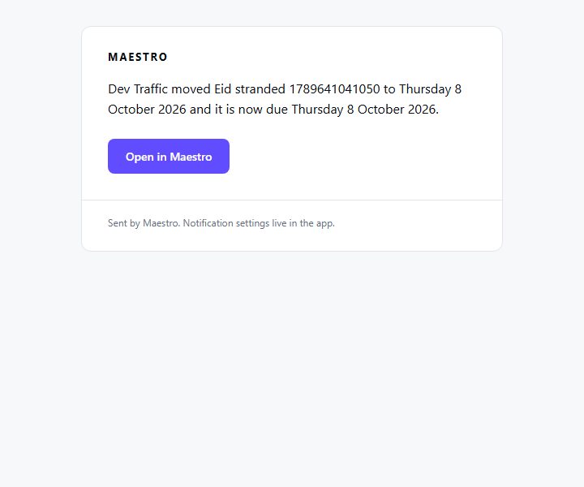

| | |
|---|---|
| **Subject** | Moved: Eid stranded 1789641041050 |
| **Sentence** | Dev Traffic moved Eid stranded 1789641041050 to Thursday 8 October 2026 and it is now due Thursday 8 October 2026. |
| **Facts** | *(none — the work has no date or hours)* |
| **Button** | *Open in Maestro* → `/schedule?on=2026-10-08` |
| **campaign** | *(none)* |
| **work** (sub_task) | `Eid stranded 1789641041050` |

## `extension_requested`

**To:** the campaign’s account manager (Action 9a). **When:** somebody asked for more time on a task.

### English

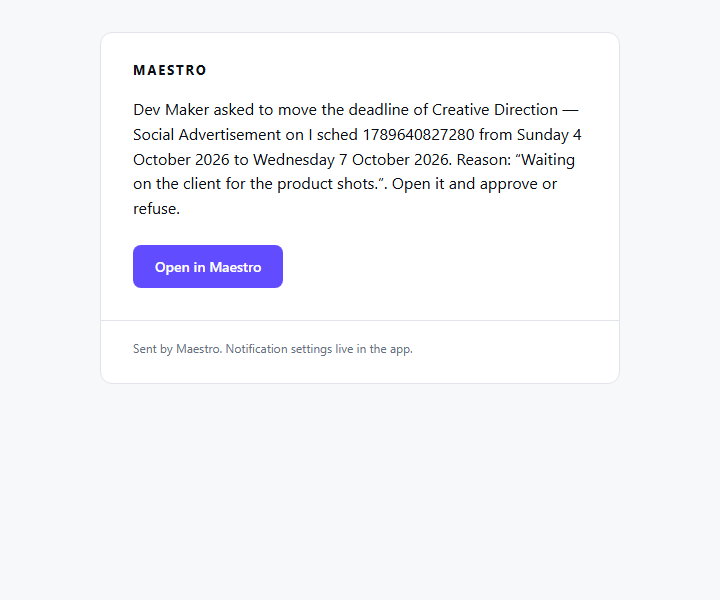

| | |
|---|---|
| **Subject** | Extension to answer: Creative Direction — Social Advertisement |
| **Sentence** | Dev Maker asked to move the deadline of Creative Direction — Social Advertisement on I sched 1789640827280 from Sunday 4 October 2026 to Wednesday 7 October 2026. Reason: “Waiting on the client for the product shots.”. Open it and approve or refuse. |
| **Facts** | *(none — the work has no date or hours)* |
| **Button** | *Open in Maestro* → `/deliverables?task=f2f8fc5c-fd6f-454b-91b5-0e68ef0eaedb` |
| **campaign** | `I sched 1789640827280` |
| **work** (sub_task) | `Creative Direction — Social Advertisement` |

## `extension_approved`

**To:** the requester and the assignee (Action 9b). **When:** the account manager approved it.

### English

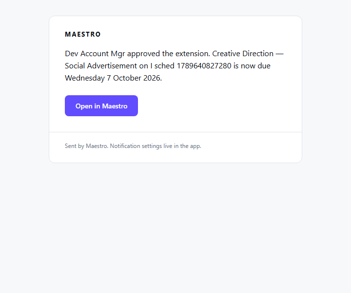

| | |
|---|---|
| **Subject** | Extension approved: Creative Direction — Social Advertisement |
| **Sentence** | Dev Account Mgr approved the extension. Creative Direction — Social Advertisement on I sched 1789640827280 is now due Wednesday 7 October 2026. |
| **Facts** | *(none — the work has no date or hours)* |
| **Button** | *Open in Maestro* → `/my-work?task=f2f8fc5c-fd6f-454b-91b5-0e68ef0eaedb` |
| **campaign** | `I sched 1789640827280` |
| **work** (sub_task) | `Creative Direction — Social Advertisement` |

## `assignment_requested`

**To:** the leads in reach of the person asked for (Action 10a). **When:** a lead tried to book someone outside their reach.

### Arabic

| | |
|---|---|
| **Subject** | طلب حجز: Write Copy — Social Advertisement |
| **Sentence** | يطلب Dev Team Lead حجز Dev Writer على «Write Copy — Social Advertisement» (I sched 1789640827280)، الاثنين، 12 أكتوبر 2026، 2 ساعة. لن يُحجز شيء قبل موافقتك — افتح الجدول للموافقة أو الرفض. |
| **Facts** | *(none — the work has no date or hours)* |
| **Button** | *افتح في مايسترو* → `/schedule?on=2026-10-12&who=Dev+Writer` |
| **campaign** | `I sched 1789640827280` |
| **work** (sub_task) | `Write Copy — Social Advertisement` |

### English

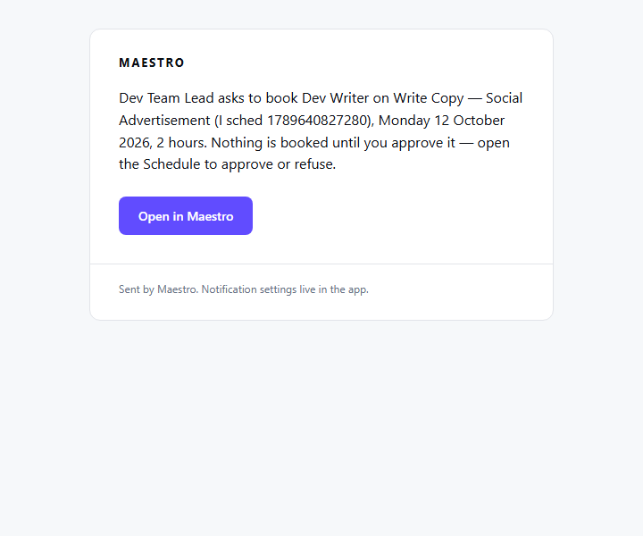

| | |
|---|---|
| **Subject** | Booking request: Write Copy — Social Advertisement |
| **Sentence** | Dev Team Lead asks to book Dev Writer on Write Copy — Social Advertisement (I sched 1789640827280), Monday 12 October 2026, 2 hours. Nothing is booked until you approve it — open the Schedule to approve or refuse. |
| **Facts** | *(none — the work has no date or hours)* |
| **Button** | *Open in Maestro* → `/schedule?on=2026-10-12&who=Dev+Writer` |
| **campaign** | `I sched 1789640827280` |
| **work** (sub_task) | `Write Copy — Social Advertisement` |

## `assignment_approved`

**To:** the requester (Action 10b). **When:** the person’s lead approved the booking.

### English

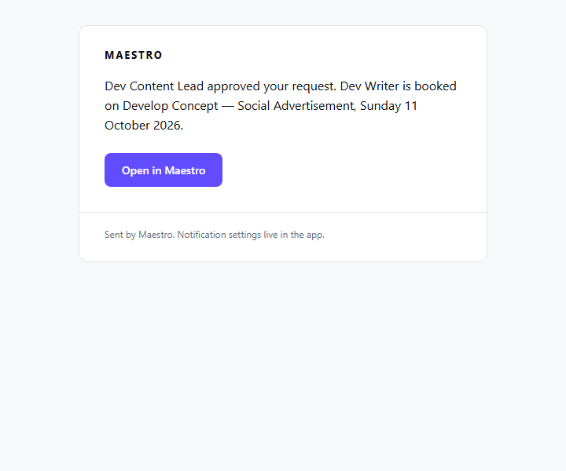

| | |
|---|---|
| **Subject** | Booking approved: Develop Concept — Social Advertisement |
| **Sentence** | Dev Content Lead approved your request. Dev Writer is booked on Develop Concept — Social Advertisement, Sunday 11 October 2026. |
| **Facts** | *(none — the work has no date or hours)* |
| **Button** | *Open in Maestro* → `/schedule?on=2026-10-11&who=Dev+Writer` |
| **campaign** | `I sched 1789640827280` |
| **work** (sub_task) | `Develop Concept — Social Advertisement` |

## `assignment_refused`

**To:** the requester (Action 10c). **When:** the person’s lead refused it.

### English

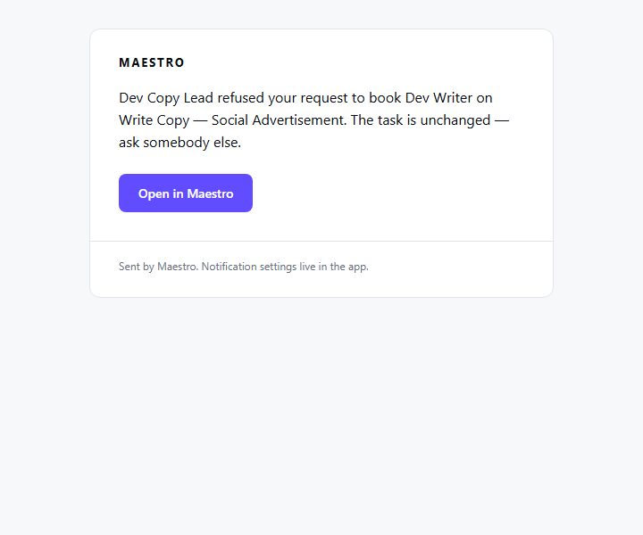

| | |
|---|---|
| **Subject** | Booking refused: Write Copy — Social Advertisement |
| **Sentence** | Dev Copy Lead refused your request to book Dev Writer on Write Copy — Social Advertisement. The task is unchanged — ask somebody else. |
| **Facts** | *(none — the work has no date or hours)* |
| **Button** | *Open in Maestro* → `/schedule?on=2026-10-12&who=Dev+Writer` |
| **campaign** | `I sched 1789640827280` |
| **work** (sub_task) | `Write Copy — Social Advertisement` |

## `chat_added`

**To:** the person added (Action 12). **When:** somebody added them to a chat group.

### English

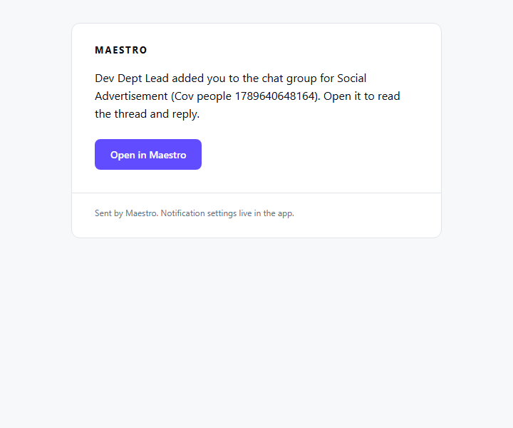

| | |
|---|---|
| **Subject** | Added to a chat group: Cov people 1789640648164 — Social Advertisement |
| **Sentence** | Dev Dept Lead added you to the chat group for Social Advertisement (Cov people 1789640648164). Open it to read the thread and reply. |
| **Facts** | *(none — the work has no date or hours)* |
| **Button** | *Open in Maestro* → `/chat?type=deliverable&id=d72198c7-6798-4b49-8ee4-fc2f2fdfec90` |
| **campaign** | `Cov people 1789640648164` |
| **work** (deliverable) | `Social Advertisement` |

## `deliverable_added`

**To:** the new deliverable’s owner; another owner on the job in one line (Action 15). **When:** a new request was attached to an existing job.

### English

*(Screenshot withheld from the public copy: deliverable_added English)*

| | |
|---|---|
| **Subject** | Added to Luma S2 Proposal 1789640746607 deck: Luma S2 Proposal 1789640746607 deck v2 |
| **Sentence** | Dev Account Mgr added Luma S2 Proposal 1789640746607 deck v2 to Luma S2 Proposal 1789640746607 deck — a new request that belongs with that job. You need to review the brief and tasks and then approve so each task can be assigned. |
| **Facts** | Sunday 4 October 2026 (Iraq time) |
| **Button** | *Open in Maestro* → `/deliverables?campaign=07388906-a31e-4301-9177-09a5466826c6&open=a73de7fa-8042-4e63-b4a8-6cde03dc7ffd` |
| **campaign** | `Luma S2 Proposal 1789640746607 deck` |
| **work** (deliverable) | `Luma S2 Proposal 1789640746607 deck v2` |

---

## Types with no sample

A type missing above was raised by no flow in the suite on this run; its words are in the same COPY
map and its row is proven in pgTAP 125. `due_soon` never emails by design (ADR-0028).

The decisions these samples implement are in
[`notification-email-copy.md`](notification-email-copy.md); this document exists so they can be read
against something real.
